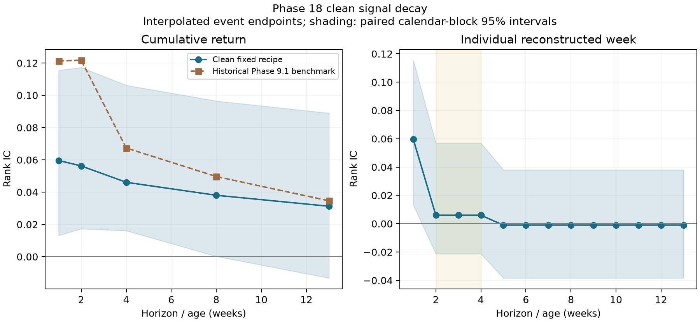

# Phase 18: Clean deterministic H=4 revalidation

**Frozen outcome B — Architecture only.** Persistence gate: False; economic gate: False; mechanical gate: True.
The clean replacement supports a **portfolio-mechanics result**, not clean predictive-persistence or robust economic confirmation. Every seed has a positive point utility delta, but the paired interval includes zero, so the frozen economic gate fails. Outcome B requires the mechanical thresholds and a nonnegative mean delta; it does **not** require or establish statistically significant economic improvement. The persistence IC is below the frozen 0.02 minimum and its permutation p exceeds 0.05; both residual-signal confidence intervals include zero.

Preregistration commit `ef1b859f7f56cacc8be9e70e60e032da8cecd170` precedes all new predictions and outcomes. The collaborative-LoRA branch stays closed. This is retrospective revalidation, not prospective confirmation or horizon search. All three clean fixed-epoch Phase 16.1 recipe reproductions were run; no Bayesian checkpoint, MC sampling, uncertainty scaling or M13 overlay entered the primary experiment.

## Provenance and scope

Read `provenance_audit.md` for the source table. Phase 16.1 did not persist clean weights or event predictions; new checkpoints reproduce its exact fixed two-epoch recipe. Weight decay 0.0 is the previously selected recipe despite the name “regularized.” Phase 17's best-validation checkpoints were deliberately excluded. Original Phase 9 predictions predate leaked Phase 11 replications; exact original outcome leakage is unverified, so old results remain historical/compromised-lineage benchmarks, never valid controls.

The exact 1728 historical holdout events were resolved uniquely by timestamp and native one-day return, then keyed by episode ID/symbol/timestamp. Model tokenization accepts only company/ticker/date. Labels use the pre-2022 cutoff -0.0365278198; no evaluation-quantile target is used. Training/validation split is chronological. Checkpoints, prediction files, texts, raw data, source, config and Git SHAs are hashed in the freeze and training manifests.

## Primary H=1 versus H=4 portfolio table

Returns/volatility/drawdown are fractions, utility is weekly; turnover is annual L1 units and cost drag is annual basis points. Annual return is arithmetic mean times 52, not CAGR. Values are arithmetic means of separately computed seed metrics.

| Metric | H=1 | H=4 |
|---|---:|---:|
| Annualized net return | 9.24% | 14.71% |
| Annualized net volatility | 19.59% | 6.62% |
| Sharpe | 0.469 | 2.223 |
| Maximum drawdown | -18.77% | -5.00% |
| Mean net weekly utility (bp) | 14.072 | 27.876 |
| Gross risky L1 turnover/year (includes entry) | 103.246 | 26.879 |
| Canonical base turnover/year (excludes entry) | 104.000 | 26.510 |
| Traded risky L1 turnover/year | 73.026 | 19.012 |
| Transaction-cost drag (bp/year) | 730.262 | 190.117 |
| Positive active names (mean) | 8.734 | 34.043 |
| Effective risky holdings (mean) | 6.260 | 20.635 |
| Cohort weight overlap (mean) | 0.00% | 74.51% |

Delta net weekly utility = **0.00138041** (13.804 bp/week), paired 95% CI [-0.00546800, 0.00843319]. Per-seed deltas: [0.00102618773255986, 0.0016805145342387025, 0.001434532091578847]; seed SD 0.00033050. The 1000 moving-block replicates share 13-calendar-week blocks across seeds; seeds are not independent market histories.

## Predictive persistence

Continuation excludes week one: incremental compounded weeks 2–4 IC 0.006027, Q5-Q1 spread 0.004147, one-sided within-entry-week permutation p=0.1050. Exact CIs and all quintiles are in `clean_signal_decay.csv`. Cumulative H=4 IC alone cannot establish post-week-one persistence.

| kind | horizon | rank_ic | ic_ci_lower | ic_ci_upper | spread | spread_ci_lower | spread_ci_upper | seed_ic_sd |
| --- | --- | --- | --- | --- | --- | --- | --- | --- |
| cumulative | 1 | 0.059634 | 0.013207 | 0.115516 | 0.011826 | 0.002352 | 0.022005 | 0.003636 |
| cumulative | 2 | 0.056237 | 0.017292 | 0.117242 | 0.013258 | 0.004042 | 0.024879 | 0.004476 |
| cumulative | 4 | 0.046109 | 0.016122 | 0.106242 | 0.016002 | 0.005581 | 0.031537 | 0.007603 |
| cumulative | 8 | 0.038065 | 0.000226 | 0.096519 | 0.013362 | 0.000771 | 0.029870 | 0.011021 |
| cumulative | 13 | 0.031270 | -0.013219 | 0.088986 | 0.009978 | -0.005541 | 0.027685 | 0.011295 |
| incremental_2_4 | 4 | 0.006027 | -0.021256 | 0.057040 | 0.004147 | -0.001147 | 0.013559 | 0.013062 |

`signal_comparison.csv` directly pairs the clean cumulative metrics with original Phase 9 values. Original Phase 9 signal calculations summed reconstructed returns and had timestamp-tie mapping problems; they are not matched clean controls. `historical_portfolio_benchmarks.csv` preserves the Phase 9.1 audited historical table.

## Decomposition: prediction, diversification, turnover and costs

A. Prediction: the above incremental gate determines persistence, independently of portfolio Sharpe.

B. Mechanics: H=4 volatility reduction 66.21%, effective-holdings ratio 3.296x. Aggregate holdings are measured by 1/sum(weight squared), after combining duplicate ticker exposures. Positive active names exclude zero optimizer weights; the historical dictionary-key count remains separately exported. Within-cohort weights are frozen at entry; cohorts each receive equal capital while active. This measures overlap/diversification under the preserved architecture; interpolated endpoint returns can also smooth volatility.

C. Turnover: H=4 traded turnover reduction 73.97%. Fees equal .001 times risky L1 volume. Base turnover excludes inception per canonical simulator, while costed traded turnover includes entry; gross risky L1 includes entry. One-way half-L1 is reported separately and never used to charge fees.

D. Net economic value: the identity below separates gross-return change, transaction-cost savings and the canonical sample-variance utility term; closure is asserted to 1e-12 for every seed. Gross-return change reflects the different held ages and cannot alone be called alpha.

| seed | delta_gross_weekly_return | weekly_cost_saving | sample_variance_utility_gain | delta_net_utility |
| --- | --- | --- | --- | --- |
| 42 | -0.000365 | 0.001039 | 0.000352 | 0.001026 |
| 123 | 0.000352 | 0.001039 | 0.000290 | 0.001681 |
| 777 | 0.000056 | 0.001039 | 0.000339 | 0.001435 |

Matched-exposure equal-weight, training-prevalence, training-only ticker-risk, and 20 frozen random-ranking controls are in `clean_h1_vs_h4.csv` and `portfolio_seed_metrics.csv`. Constant ranking IC/quintiles are undefined rather than manufactured from tie order. `forecast_controls.csv` evaluates clean labels. These baselines are diagnostic; none changes continuation thresholds.

## Accounting checks and scientific limits

The existing Phase 9.1 return builder and cohort simulator were reused without modification. H=1 matches the canonical ledger after the simulator's entry fee is aligned (see `h1_reproduction.csv`); H=4 age selection, equal capital and expiration have hand-calculated tests.

Returns are **geometrically interpolated event endpoints, not observed weekly marks**: weeks 2–4 share the same per-event drift, as do weeks 5–13. Thus three positive reconstructed week ICs are not three independent persistence observations. H=1 is a one-day move treated as a weekly observation. Next-quarter endpoint fallback counts: {'missing_30d': 0, 'missing_next_quarter': 301, 'corporate_action_guard': 0}. 69 occupied weeks span 72 calendar weeks, including 3 empty weeks. Simulator horizons age by occupied buckets; terminal cohorts are censored without liquidation, exactly as historical accounting. Intraweek execution availability and adjusted weekly prices are not established by this data. No endpoint enters features, selection or weights; endpoints only score frozen predictions and returns.

The frozen numerical classification is not revised for these limitations. Even numerical outcome A would establish only an endpoint-reconstruction result; genuine observed multiweek alpha requires actual weekly prices and a prospectively causal execution audit. A positive architecture result without persistence is not alpha confirmation.

## Reproduction

Run `PYTHONPATH=src:. python experiments/run_phase18_clean_cohort_revalidation.py --stage train --device mps`, then the targeted tests, then `--stage evaluate`. This execution used three parallel CPU workers on an isolated GCP n2-standard-32 VM, with 8 threads per seed, torch 2.9.1+cpu and transformers 5.16.1. Public FinBERT weights at the exact frozen revision were SHA256-verified before offline training; fixed recipe reproduction does not imply bitwise equivalence across backends. A completed seed resumes only after config/prediction/checkpoint hashes match. No new portfolio outcome is evaluated before the Git preregistration check. Execution SHA `d8d9255e44cb60c7354949534517e217f3d3ebb4` and runner hash `98ff9d43163bdeaf4fc4695b9152f222b4e6641ac8f443972fdfc0705a1bc7ff` are saved. Validation results are not consulted to choose checkpoints.

## Corrected historical signal comparison

The supplementary comparison uses the audited Phase 9.1 endpoint reconstruction. Both old tables remain historical/compromised-lineage benchmarks, not valid controls. No old prediction was used to select the replacement model or continuation criteria.

| horizon | rank_ic | mean_rank_ic | spread | cumulative_q5_q1_spread |
| --- | --- | --- | --- | --- |
| 1 | 0.059634 | 0.121249 | 0.011826 | 0.024034 |
| 2 | 0.056237 | 0.121760 | 0.013258 | 0.021465 |
| 4 | 0.046109 | 0.067357 | 0.016002 | 0.016326 |
| 8 | 0.038065 | 0.049665 | 0.013362 | 0.011648 |
| 13 | 0.031270 | 0.034635 | 0.009978 | 0.005800 |

Column `rank_ic`/`spread` is clean; `mean_rank_ic`/`cumulative_q5_q1_spread` is historical Phase 9.1. Original Phase 9 comparison remains in `signal_comparison.csv`.

Mean utility attribution: gross-return change **0.145 bp/week**, cost saving **10.387 bp/week**, variance term **3.272 bp/week**. These sum to **13.804 bp/week**. The point gain is overwhelmingly fees and variance, rather than an increase in gross return.

## Frozen controls and clean target calibration

| system | brier | log_loss | prevalence | prediction_mean |
| --- | --- | --- | --- | --- |
| constant_prevalence | 0.197766 | 0.587763 | 0.262731 | 0.198999 |
| ticker_risk | 0.195999 | 0.584449 | 0.262731 | 0.191411 |
| clean_seed_42 | 0.203147 | 0.606316 | 0.262731 | 0.160413 |
| clean_seed_123 | 0.206608 | 0.620221 | 0.262731 | 0.143966 |
| clean_seed_777 | 0.201042 | 0.599366 | 0.262731 | 0.168359 |

The holdout downside frequency is 26.273% under the pre-2022 training-defined cutoff; the training prevalence is 19.900%. These are not holdout-quantile labels. On these labels, all three clean reproductions have worse Brier/log loss than the constant-prevalence and training-only ticker-risk controls. This diagnostic does not change the frozen ranking/portfolio criteria. The Phase 16.1 headline calibration numbers are not directly replicated on a different target definition and unavailable original weights.

| system | horizon | annualized_return | annualized_volatility | mean_net_utility |
| --- | --- | --- | --- | --- |
| clean_lora | 1 | 0.092381 | 0.195858 | 0.001407 |
| clean_lora | 4 | 0.147149 | 0.066179 | 0.002788 |
| constant_prevalence | 1 | -0.000703 | 0.177107 | -0.000315 |
| constant_prevalence | 4 | 0.101964 | 0.060794 | 0.001925 |
| equal_weight | 1 | -0.000703 | 0.177107 | -0.000315 |
| equal_weight | 4 | 0.101964 | 0.060794 | 0.001925 |
| random_ranking | 1 | 0.021705 | 0.204112 | 0.000015 |
| random_ranking | 4 | 0.108790 | 0.066632 | 0.002049 |
| ticker_risk | 1 | 0.093994 | 0.230886 | 0.001295 |
| ticker_risk | 4 | 0.127267 | 0.069643 | 0.002401 |

Equal-weight and constant predictions coincide under the frozen simplex optimizer. Their H=4 mechanical gains, and the random-ranking gains, further demonstrate that overlap and entry-cost dilution can improve metrics without persistent model alpha. No inference test establishing clean superiority to these controls was preregistered or claimed.

## Execution, validation, cost and retention

All three seeds completed the frozen recipe. The returned archive has 6,815,395 bytes and SHA256 `b672ed4a7f696fd571c4412364d84abe3dfe97a31184f9b0fcf685b36ee315df`; all 25 individual result/log hashes matched. Checkpoint shapes/finite tensors, exact OOS event coverage, prediction range, provenance/leakage and H=1/H=4 mechanics passed 24 targeted tests. The full repository passed **278 tests, 3 skipped**; Ruff passed. Logs are retained in this directory and `cloud_logs/`.

The successful parallel training/inference took **18.31 minutes**; local frozen evaluation took **1.70 minutes**. Total conservative usage-cost estimate is **$1.2933 USD**, including all three VM attempts, disk/IP and result-payload egress. This is not an invoiced charge; credits/taxes and billing export are unavailable. See `compute_cost_report.md` and official price/lifecycle JSON records.

The Spot training attempt was preempted and auto-deleted before any seed completed. Its worker logs were lost with the disk; available boot/lifecycle logs and retained observations are preserved, with this limitation explicitly recorded. The initial incompatible audio environment also failed before training. Neither failure produced evaluated outcomes or changed the recipe. A standard VM completed the full matrix from scratch. No credentials or unrelated local data were transferred.

All temporary experiment VMs and boot disks are confirmed absent; all cloud-resident payloads were confined to those disks and removed. Checkpoints/predictions/reports/logs/manifests are retained locally for reproducibility. No other-project resource was modified. `cloud_cleanup_verification.json` records the final resource checks.

The frozen evaluator generates the base scientific report; this retained finalized report additionally records postrun validation, cloud attempts, costs and cleanup. `experiments/report_phase18_clean_cohort_revalidation.py` regenerates the descriptive Phase 9.1 comparison CSV and PNG/PDF from completed outputs without running or changing the experiment.
