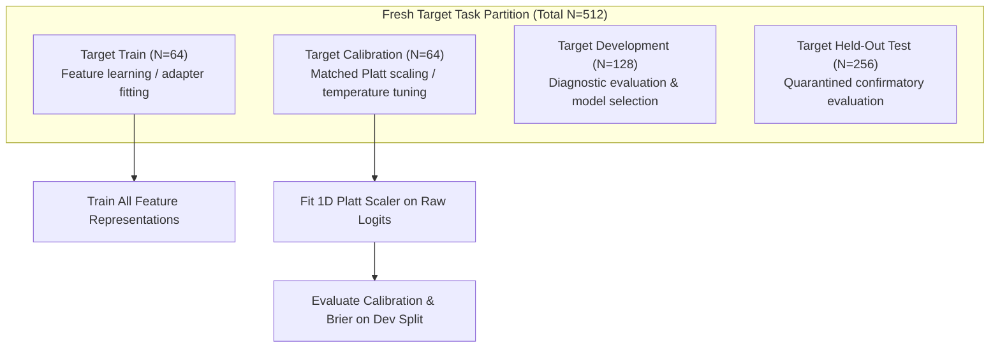

# Prospective Research Plan: Equal-Budget Calibration Diagnostic for Collaborative Multi-Task Representations

**Document Version:** 1.0  
**Date:** 2026-10-10  
**Status:** **PROSPECTIVE DESIGN PLAN (LOCKED — PENDING FUTURE AUTHORIZATION)**  
**Repository:** `distributed-portfolio-learning`  
**Branch:** `experiment/collaborative-lora-transferability`  
**Preceding Document:** [`docs/collaborative_lora_transfer_closure.md`](collaborative_lora_transfer_closure.md)  

---

## 1. Scientific Motivation & Core Research Question

In the Multi-Task LoRA Transferability Benchmark (`docs/collaborative_lora_transfer_closure.md`), we established a critical empirical dissociation:
- **Representation Recovery & Discrimination:** Structural CoLoRA ($M_{\text{CoLoRA}}$) and Shared-Subspace ($M_{\text{subspace}}$) successfully recovered the latent $r=2$ subspace ($S_{\text{proj}} \approx 0.68$) and significantly improved target weight cosine similarity ($0.731$ vs. $0.600$) and discriminative ranking (+0.051 AUROC) over single-task training under severe target sample scarcity ($N_{\text{train}}=64$).
- **Primary Brier Failure:** In probability Brier score, both collaborative models failed to outperform single-task logistic regression ($0.2878$ vs. $0.2897$), while trailing Output Calibrated Fusion ($0.1923$) and Pooled LoRA ($0.2164$).
- **Root Cause Identified:** CoLoRA and Subspace models suffered from extreme logit overconfidence (Expected Calibration Error $\text{ECE} \approx 0.25-0.27$). Because Brier score quadratically penalizes probability errors, extreme probabilities on misclassified target examples erased the rank-ordering gains. Meanwhile, Output Fusion and Pooled LoRA achieved low Brier primarily due to low calibration error ($\text{ECE} \approx 0.06-0.07$).

### Core Research Question
> **When provided with an equal target calibration budget, does post-hoc probability calibration allow a collaboratively learned representation to convert its superior feature orientation and discrimination into verified probability Brier score improvements?**

---

## 2. Experimental Principles & Fresh Split Design

To prevent any data contamination from prior runs, this diagnostic will be conducted on **entirely fresh synthetic splits** using a dedicated seed sequence (`base_seed = 20261100`):

### 2.1 Target Split Accounting ($N = 512$ total per seed)
1. **Target Train ($N_{\text{train}} = 64$):** Severe data scarcity regime for fitting initial models.
2. **Target Calibration ($N_{\text{cal}} = 64$):** Strictly isolated calibration split used exclusively to fit a 1D Platt scaler ($a \cdot z + b$) or calibrate output fusion.
3. **Target Development ($N_{\text{dev}} = 128$):** Diagnostic evaluation split for metric computation.
4. **Target Confirmatory Test ($N_{\text{test}} = 256$):** Quarantined until all prospective gates pass.

---

## 3. Matched-Budget Model Suite

All candidate models receive **strictly matched access** to target data:

| Model ID | Base Representation | Training Target Budget ($N$) | Calibration Target Budget ($N$) | Total Target Labels ($N_{\text{total}}$) | Calibration Mechanism |
| :--- | :--- | :---: | :---: | :---: | :--- |
| **$M_{0,\text{raw}}$** | Target-Only Logistic | 64 | 0 | 64 | None (Raw logits) |
| **$M_{0,\text{cal}}$** | Target-Only Logistic | 64 | 64 | 128 | Platt Scaling on $N_{\text{cal}}$ |
| **$M_{0,\text{pooled}}$** | Target-Only Logistic | 128 ($64 + 64$) | 0 | 128 | Full retraining on Train + Cal |
| **$M_{1,\text{raw}}$** | Pooled Global LoRA ($N_{\text{src}}=1536$) | 64 | 0 | 64 | None (Raw logits) |
| **$M_{1,\text{cal}}$** | Pooled Global LoRA ($N_{\text{src}}=1536$) | 64 | 64 | 128 | Platt Scaling on $N_{\text{cal}}$ |
| **$M_{\text{subspace},\text{raw}}$** | Shared-Subspace Multi-Task | 64 | 0 | 64 | None (Raw logits) |
| **$M_{\text{subspace},\text{cal}}$** | Shared-Subspace Multi-Task | 64 | 64 | 128 | Platt Scaling on $N_{\text{cal}}$ |
| **$M_{\text{CoLoRA},\text{raw}}$** | Structural CoLoRA | 64 | 0 | 64 | None (Raw logits) |
| **$M_{\text{CoLoRA},\text{cal}}$** | Structural CoLoRA | 64 | 64 | 128 | Platt Scaling on $N_{\text{cal}}$ |
| **$M_{\text{fuse}}$** | 3 Source Specialists | 0 | 64 | 64 (or 128) | Multivariate log-odds on $N_{\text{cal}}$ |
| **$M_{\text{oracle}}$** | Bayes Optimal Oracle | 0 | 0 | 0 | Exact analytical DGP |

### 3.1 Post-Hoc Calibration Formulation
For each uncalibrated model producing logit $z(x) = \hat{w}^T x + \hat{b}$, a calibrated probability is formed via univariate logistic regression on $D_{\text{cal}}$:
$$p_{\text{cal}}(x) = \sigma(a \cdot z(x) + b)$$
where $a > 0$ acts as inverse temperature and $b$ corrects base-rate shift.

---

## 4. Primary Hypotheses & Prospective Decision Criteria

### Hypothesis H1: Probability Calibration Bridge
- **Prediction:** Equal-budget Platt scaling significantly reduces ECE and improves Brier score for both collaborative architectures:
  $$\Delta \text{Brier}(M_{\text{CoLoRA},\text{cal}} - M_{\text{CoLoRA},\text{raw}}) < -0.050$$
- **Falsification Condition:** If post-hoc calibration does not reduce Brier, logit miscalibration is not the primary driver of Brier failure.

### Hypothesis H2: Collaborative Value Under Equal Calibration Access
- **Prediction:** Under matched calibration budgets ($N_{\text{total}} = 128$), $M_{\text{CoLoRA},\text{cal}}$ significantly outperforms single-task baselines:
  $$\text{Brier}(M_{\text{CoLoRA},\text{cal}}) < \text{Brier}(M_{0,\text{cal}}) \quad \text{and} \quad \text{Brier}(M_{\text{CoLoRA},\text{cal}}) < \text{Brier}(M_{0,\text{pooled}})$$
- **Falsification Condition:** If $M_{0,\text{pooled}}$ matches or beats $M_{\text{CoLoRA},\text{cal}}$, then simply gathering 64 additional target labels is more effective than representation sharing from 1,536 source samples.

### Hypothesis H3: Invariance Across Representation Parameterizations
- **Prediction:** Calibrated CoLoRA ($M_{\text{CoLoRA},\text{cal}}$) and Calibrated Shared-Subspace ($M_{\text{subspace},\text{cal}}$) achieve identical calibrated performance:
  $$|\text{Brier}(M_{\text{CoLoRA},\text{cal}}) - \text{Brier}(M_{\text{subspace},\text{cal}})| < 0.005$$
  confirming that benefits derive entirely from subspace learning rather than LoRA-specific trilinear factorizations.

### Hypothesis H4: Representation Sharing vs. Prediction Fusion Under Matched Budgets
- **Prediction:** Under matched calibration access ($N_{\text{cal}}=64$), $M_{\text{CoLoRA},\text{cal}}$ matches or exceeds $M_{\text{fuse}}$ in Brier score, eliminating the previous artifact where $M_{\text{fuse}}$ had exclusive calibration access.

---

## 5. Statistical Power & Replication Design

To address the high seed variability observed in the closure audit ($S=3$ was underpowered):
- **Replication Count:** $S = 10$ independent dataset draws (seeds $20261101, \dots, 20261110$).
- **Statistical Testing:** Paired two-sided Wilcoxon signed-rank test and paired cluster bootstrap (95% CI) across all 10 replications with Holm-Bonferroni family-wise error correction.
- **Hardware & Resource Limits:** CPU only, strictly 2 threads, estimated total runtime $< 45$ seconds.

---

## 6. Execution Status & Next Action

- **Current Status:** **LOCKED & PROSPECTIVE ONLY.**
- **No code implementation or training execution has been performed.**
- **Next Decision Gate:** Await explicit user authorization before creating experiment branches, generating datasets, or running code.
