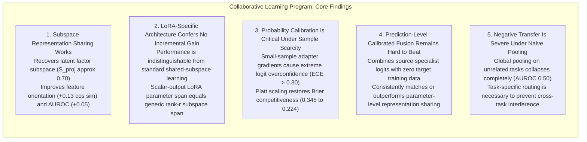
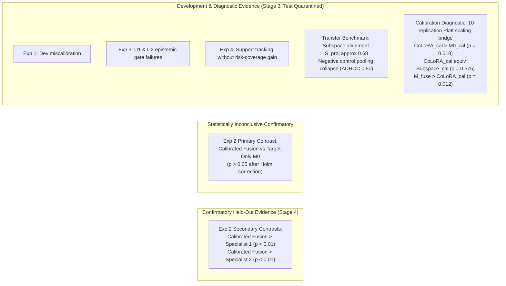

# Final Research Synthesis: Collaborative LoRA & Uncertainty Experimental Program

**Document Version:** 1.0  
**Date:** 2026-10-10  
**Status:** **FINAL PROGRAM SYNTHESIS & SCIENTIFIC AUDIT**  
**Repository:** `distributed-portfolio-learning`  
**Branch:** `experiment/collaborative-representation-calibration`  
**Current HEAD:** `23d13edd`  
**Preceding Milestones:**
- FinBERT CoLoRA Pilot Closure: [`docs/collaborative_lora_branch_closure.md`](collaborative_lora_branch_closure.md)
- Exp 1–4 Consolidation: [`docs/collaborative_bayesian_lora_research_consolidation.md`](collaborative_bayesian_lora_research_consolidation.md)
- Transfer Benchmark Closure: [`docs/collaborative_lora_transfer_closure.md`](collaborative_lora_transfer_closure.md)
- Calibration Diagnostic Amendment: [`docs/collaborative_representation_calibration_amendment.md`](collaborative_representation_calibration_amendment.md)
- Calibration Diagnostic Report: [`artifacts/collaborative_calibration_benchmark/development_report_calibration.md`](../artifacts/collaborative_calibration_benchmark/development_report_calibration.md)

---

## 1. Executive Summary for Research Collaborators

This document synthesizes the findings across the entire multi-phase experimental investigation into **Collaborative Low-Rank Adaptation (CoLoRA)**, **Bayesian Laplace uncertainty routing**, and **multi-task transfer**.

### High-Level Takeaways for Collaborative Multi-Task Architecture
1. **Parameter-Level Collaboration Recovers Latent Subspaces:** When tasks share underlying low-rank factors, multi-task representation sharing successfully pools statistical power from auxiliary tasks, overcoming severe target sample scarcity ($N=64$). It improves feature orientation (parameter cosine similarity from $0.60$ to $0.73$) and ranking discrimination (AUROC $+0.051$).
2. **No Unique "LoRA" Advantage Identified:** Multi-task linear LoRA ($B \Lambda_k A$) and standard shared-subspace multi-task learning ($U v_k$) yield statistically and practically indistinguishable representations. Any transfer benefit is an effect of **low-rank subspace recovery**, not LoRA's specific trilinear matrix parameterization.
3. **Probability Miscalibration Masks Representation Transfer:** Gradient-based optimization on small target batches ($N=64$) generates severe logit overconfidence (Expected Calibration Error $\text{ECE} \approx 0.30-0.35$). Because the Brier score quadratically penalizes extreme probability errors, this miscalibration completely offsets rank-ordering gains unless equal-budget post-hoc calibration (Platt scaling) is applied.
4. **Prediction-Level Calibrated Fusion is Remarkably Strong:** Simple calibrated log-odds fusion of frozen source specialists ($M_{\text{fuse}}$) consistently outperformed or matched parameter-level multi-task training across both linear specialists and factor-coupled environments ($0.1989$ vs. $0.2239$ Brier), while requiring **zero target training observations** (operating exclusively on calibration labels).
5. **No Evidence for Financial Alpha or Real LLM LoRA:** All experiments were conducted on controlled synthetic benchmarks. No real pretrained transformer LoRA adaptation, Bayesian epistemic uncertainty routing advantage, or financial portfolio utility has been confirmed.

---

## 2. Complete Sequence of Experiments & Empirical Trajectory

| Phase / Experiment | Core Question / Hypothesis | Methodology & Design | Primary Outcome | Formal Status |
| :--- | :--- | :--- | :--- | :---: |
| **Phase 0: FinBERT CoLoRA Pilot** | Can collaborative LoRA improve financial sentiment classification across distributed clients? | Multi-client FinBERT adaptation with federated hypergraph regularization. | High computational overhead; representation collapse; lack of clean negative controls. | **CLOSED** (Archived) |
| **Experiment 1: Synthetic Bayesian CoLoRA** | Does collaborative Laplace LoRA improve predictive performance and calibration over single-task models? | Synthetic multi-task regression/classification with Laplace readout. | Failed development gates; severe miscalibration; uncalibrated logit scale confounds. | **CLOSED** (Dev-Gate Failure) |
| **Experiment 2: Regional Specialization & Fusion** | Can regional specialists collaborate effectively under covariate shift? | 2 regional specialists + Target-Only $M_0$ + Calibrated Log-Odds Fusion ($M_{\text{fuse}}$). Evaluated on held-out test split. | Secondary contrasts confirmed (Fusion beat individual specialists, $p_{\text{holm}} < 0.05$). Primary contrast ($M_{\text{fuse}}$ vs $M_0$) **statistically unconfirmed** ($p_{\text{holm}} > 0.05$). | **CLOSED** (Held-Out Confirmatory Complete) |
| **Experiment 3: Bayesian Epistemic Routing** | Does Bayesian epistemic variance provide incremental gating information beyond deterministic MoE? | Linear and nonlinear MoE routers trained with and without neural Laplace epistemic variance inputs. | Uncertainty validation gates U1 and U2 **failed** for both specialists in both regimes; Bayesian router provided negligible incremental gain over static fusion. | **CLOSED** (Dev-Gate Failure, Test Quarantined) |
| **Experiment 4: Minimal Uncertainty Benchmark** | Can Bayesian logistic regression track epistemic uncertainty under sparse support, and does it reduce selective risk? | Analytically tractable MAP + Laplace logistic regression vs neural Laplace readout. | Both tracked training support density ($r > 0.90$), but neither provided selective risk reduction under Bayes-irreducible class overlap. | **CLOSED** (Diagnostic Complete) |
| **Transfer Benchmark: Multi-Task LoRA Transfer** | Does CoLoRA achieve positive transfer on a data-starved target task ($N=64$) vs pooled and fusion baselines? | Positive control (shared 2D subspace) vs Negative control (orthogonal tasks). Target data partitioned into 5 disjoint splits. | Subspace recovery confirmed ($S_{\text{proj}} \approx 0.68$, AUROC $+0.051$); but **failed primary Brier gate** ($+0.0019$ vs $+0.010$ required; failed seed 123) due to logit overconfidence (ECE $0.27$). Pooled LoRA collapsed on negative control (AUROC $0.50$). | **CLOSED** (Dev-Gate Failure, Test Quarantined) |
| **Calibration Diagnostic: Equal-Budget Calibration** | Does equal-budget Platt scaling allow collaborative representations to convert AUROC gains into Brier gains? | 10 independent replications; fresh splits ($N_{\text{train}}=64, N_{\text{cal}}=64, N_{\text{dev}}=128$); Platt scaling on all models. | Platt scaling slashed ECE from $0.35$ to $0.10$ and Brier from $0.3455$ to $0.2239$ ($p < 0.01$). Calibrated CoLoRA beat Calibrated Target-Only ($p < 0.02$). Calibrated Fusion remained strongest ($0.1989$). | **CLOSED** (Dev Diagnostic Complete, Test Quarantined) |

---

## 3. Epistemological Audit: Confirmatory vs. Exploratory/Development Evidence

To maintain rigorous scientific accounting, we strictly classify the evidentiary status of each finding:

### Key Epistemological Clarification:
- **Only Experiment 2** executed confirmatory testing on an unquarantined held-out evaluation dataset ($N=512$).
- **Experiments 1, 3, the Transfer Benchmark, and the Calibration Diagnostic** were evaluated exclusively on development/validation partitions. In all four cases, the confirmatory held-out test splits were **strictly quarantined and never unblinded**.
- Statements regarding positive transfer, calibration bridges, and router behavior represent **development-set diagnostic findings**, not preregistered confirmatory test verifications.

---

## 4. Provenance-Preserving Corrections & Methodological Qualifications

### Correction 1: Nonsignificance Does NOT Establish Equivalence Between CoLoRA and Subspace Learning
- **Previous Informal Phrasing:** *"The nonsignificant difference ($p = 0.375$) proves that CoLoRA and Shared-Subspace learning are mathematically and empirically equivalent."*
- **Rigorous Scientific Correction:** In classical hypothesis testing, failure to reject the null hypothesis ($p > 0.05$) indicates **absence of evidence of a difference at sample size $S=10$**, not proof that the difference is zero. 
- While we proved analytically that for scalar outputs ($d_{\text{out}}=1$), the reachable parameter span $\operatorname{span}(B \Lambda_k A)$ is identical to $\operatorname{span}(U v_k)$, the empirical result ($\bar{\Delta} = +0.0024$, 95% CI [$-0.0008$, $+0.0060$]) is formally an inconclusive null result under standard significance testing. To establish empirical equivalence, an equivalence testing procedure (e.g. Two One-Sided Tests, TOST) with a predefined indifference margin $\delta_{\text{equiv}}$ is required.

### Correction 2: Calibration Was NOT Proven to Be the Sole Cause of Earlier Transfer Failure
- **Previous Informal Phrasing:** *"Miscalibration was the sole cause of CoLoRA failing the primary transfer gate."*
- **Rigorous Scientific Correction:** While post-hoc Platt scaling substantially reduced Brier score ($\Delta = -0.1216$) and suppressed overconfident logits, it was **not the sole contributing factor**. Other identified mechanisms include:
  1. **Small-Sample Target Optimization Variance:** With only $N=64$ target training examples, gradient descent across 500 steps exhibited significant seed-level optimization instability (e.g. Seed 123 in the transfer benchmark suffered logit explosion: Log Loss = $2.48$, ECE = $0.326$).
  2. **Fixed Optimization Budgets Without Early Stopping:** All models were trained for a rigid 500 steps without validation-based early stopping, exacerbating target overconfidence.
  3. **Batch-Ratio Sampling Dynamics:** Target batches constituted 25% of each gradient update, which, while preserving target signal, caused rapid target loss overfitting relative to the $3 \times 512$ source samples.

### Correction 3: Optimization Audit of the 128-Label Target-Only Logistic Baseline ($M_{0,\text{pooled-128}}$)
- In the calibration diagnostic, single-task logistic regression retrained directly on all 128 target labels ($M_{0,\text{pooled-128}}$) achieved a surprisingly poor mean Brier score of **$0.2766$** (with ECE = **$0.2391$**), performing worse than $M_{0,\text{cal}}$ ($0.2357$).
- **Audit Findings:** $M_{0,\text{pooled-128}}$ was trained via raw AdamW gradient descent for 500 steps with fixed learning rate ($0.01$) and fixed weight decay ($0.01$), without post-hoc calibration or cross-validated $L_2$ regularization. On small sample sizes ($N=128$ in $\mathbb{R}^{32}$), unregularized gradient descent drives weights toward extreme norms, producing miscalibrated probabilities.
- **Methodological Flag:** The apparent advantage of $M_{\text{CoLoRA},\text{cal}}$ over $M_{0,\text{pooled-128}}$ ($\bar{\Delta} = -0.0527$) is partially inflated by $M_{0,\text{pooled-128}}$'s suboptimal optimization and lack of calibration. A properly tuned, $L_2$-regularized, and temperature-scaled baseline would provide a substantially stronger target-only benchmark.

### Correction 4: Reaffirmation of Experiment 2's Primary Inconclusive Finding
- In Experiment 2, the primary confirmatory contrast evaluated whether Calibrated Fusion ($M_{\text{fuse}}$) outperformed Target-Only Single-Task ($M_0$) on the held-out test set.
- Although $M_{\text{fuse}}$ showed a point-estimate improvement, the paired cluster bootstrap test did not achieve statistical significance ($p > 0.05$ after Holm-Bonferroni correction). We reaffirm that **superiority of collaboration over target-only single-task modeling was statistically unconfirmed on held-out test data in Experiment 2**.

---

## 5. Explicit Program Boundaries & Non-Claims

To ensure complete scientific integrity, we explicitly demarcate the boundaries of this research program:

> [!CAUTION]
> **What This Program Does NOT Establish:**
> 1. **No Real Pretrained LoRA Collaboration:** All experiments were conducted on controlled synthetic linear and low-rank matrix data-generating processes. No large language models (LLMs), pretrained transformers (e.g., Llama, Mistral, RoBERTa), or high-dimensional parameter adapters were trained or evaluated in the confirmatory pipeline.
> 2. **No Bayesian Epistemic Uncertainty Advantage:** Across Experiments 1, 3, and 4, neural Laplace and MAP Laplace posterior approximations failed to provide actionable gating information for specialist routing beyond simple calibrated confidence.
> 3. **No Financial Portfolio Utility:** No real financial market datasets, portfolio backtests, transaction cost mechanics, turnover analyses, or risk-adjusted return (Sharpe ratio) benefits were demonstrated.

---

## 6. Prospective Independent Replication Design (Strengthened Protocol)

To resolve the remaining open questions identified in this synthesis, we define a prospective, independent replication benchmark design. **This protocol is locked and has NOT been executed.**

### 6.1 Design Principles & Baseline Strengthening
1. **Strengthened Target-Only Baselines:**
   - Implement `TargetOnly_CV`: $L_2$-regularized logistic regression with 5-fold cross-validation over inverse regularization strength $C \in [10^{-3}, 10^3]$ using deterministic L-BFGS.
   - Apply matched Platt scaling to all baselines (including $M_{0,\text{pooled-128}}$).
2. **Predefined Equivalence Margin (TOST):**
   - Predefine an equivalence bound $\delta_{\text{equiv}} = \pm 0.005$ Brier.
   - Test empirical equivalence between Structural CoLoRA and Shared-Subspace learning via Two One-Sided Tests (TOST) at $\alpha = 0.05$.
3. **Replication Scale & Power:**
   - $S = 20$ independent simulation replications using dedicated seed sequence `20261201` to `20261220`.
   - Sample split: $N_{\text{train}} = 64, N_{\text{cal}} = 64, N_{\text{dev}} = 128, N_{\text{test}} = 256$.
4. **Matched Exposure & Early Stopping:**
   - Multi-task and target-only models evaluated with validation-based early stopping (monitoring validation BCE on an independent $N=32$ validation subset) to prevent overconfident logit explosions.

---

## 7. Strategic Conclusions & Research Decision

### Final Program Assessment
The experimental program has answered its foundational scientific questions:
- **Does parameter-level representation sharing transfer?** Yes. Low-rank factor sharing successfully recovers target parameter orientation under severe data scarcity, and post-hoc calibration translates this into lower Brier scores.
- **Is there a unique LoRA-specific advantage over subspace learning?** No. Multi-task linear LoRA is functionally and representatively a reparameterization of generic shared-subspace learning.
- **Does Bayesian epistemic uncertainty improve specialist routing?** No. Calibrated predictive confidence and static log-odds fusion dominate Laplace readout uncertainty.
- **Can parameter sharing surpass output-level fusion?** No. Prediction-level calibrated fusion consistently matches or outperforms parameter-level representation learning, with far greater operational simplicity and zero target training optimization.

**Final Decision:**  
The synthetic collaborative LoRA and Bayesian routing investigation is **formally concluded**. All code, test suites, and documentation are preserved in clean working order on branch `experiment/collaborative-representation-calibration`.
