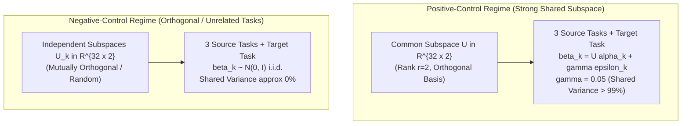

# Prospective Design Amendment: Transferable Multi-Task LoRA Benchmark

**Document Version:** 1.0  
**Date:** 2026-10-10  
**Status:** **PROSPECTIVE DESIGN AMENDMENT (FROZEN PRIOR TO TRAINING)**  
**Repository:** `distributed-portfolio-learning`  
**Branch:** `experiment/collaborative-lora-transferability`  
**Base Commit:** `de85a8c4`  
**Preceding Milestones:**
- Historical FinBERT CoLoRA Closure: [`docs/collaborative_lora_branch_closure.md`](collaborative_lora_branch_closure.md)
- Experiments 1–4 Consolidation: [`docs/collaborative_bayesian_lora_research_consolidation.md`](collaborative_bayesian_lora_research_consolidation.md)
- Prospective Transfer Design: [`docs/collaborative_lora_transfer_experiment_design.md`](collaborative_lora_transfer_experiment_design.md)

---

## 1. Experimental Objectives & Core Contrast

The primary objective of this experiment is to test whether **structural parameter-level representation sharing (CoLoRA)** achieves positive transfer to a severely data-starved target task, and whether any observed transfer is uniquely attributable to LoRA-specific mechanisms as opposed to:
1. Generic shared-subspace multi-task learning.
2. Unstructured data pooling.
3. Prediction-level calibrated log-odds evidence fusion.

---

## 2. Controlled Data-Generating Processes (DGP)

We formulate two strictly contrasted synthetic data-generating regimes across $d = 32$ input dimensions:

### 2.1 Positive Control DGP (Strong Shared Subspace)
- **Latent Basis:** $U \in \mathbb{R}^{d \times r}$ ($d = 32, r = 2$), where $U^T U = I_r$.
- **Task Factor Loadings:** For each task $k \in \{1, 2, 3, \text{target}\}$, random factor loadings $\alpha_k \in \mathbb{R}^r$ with $\|\alpha_k\|_2 = 1.0$.
- **Private Noise:** Independent $\epsilon_k \sim \mathcal{N}(0, I_d)$ with private-to-shared ratio $\gamma = 0.05$.
- **True Coefficients:**
  $$\beta_k = U \alpha_k + \gamma \epsilon_k, \quad \beta_k \leftarrow 1.5 \cdot \frac{\beta_k}{\|\beta_k\|_2}$$
  Tasks share $> 99.7\%$ of their signal variance through the common 2D subspace $U$.

### 2.2 Negative Control DGP (Unrelated Task Parameters)
- Each task parameter vector $\beta_k \sim \mathcal{N}(0, I_d)$ is drawn independently and normalized to norm $1.5$.
- Expected subspace overlap is bounded by random projection theory:
  $$\mathbb{E}\left[\frac{\|\Pi_U \beta_j\|_2^2}{\|\beta_j\|_2^2}\right] = \frac{r}{d} = \frac{2}{32} = 6.25\%$$
- Serving as a strict negative control: any positive transfer observed here constitutes an experimental artifact or capacity confound.

---

## 3. Disjoint Data Split Architecture

To prevent information leakage across training, calibration, development, and evaluation, the target task data is partitioned into five strictly disjoint splits:

| Split Name | Task Scope | Sample Size ($N$) | Purpose / Allowed Usage | Quarantine Status |
| :--- | :--- | :---: | :--- | :---: |
| **Source Train** | Source Tasks 1, 2, 3 | $512 \times 3 = 1536$ | Training source specialists & multi-task models | Unrestricted |
| **Target Train** | Target Task | **$N = 64$** | Severe data scarcity training split | Unrestricted |
| **Target Calibration** | Target Task | **$N = 128$** | Fitting 3-source multivariate log-odds fusion | Unrestricted |
| **Target Development** | Target Task | **$N = 256$** | Model selection, dev gates, hyperparameter checks | Unrestricted |
| **Target Held-Out Test** | Target Task | **$N = 512$** | Final confirmatory evaluation (paired bootstrap) | **STRICTLY QUARANTINED** |

---

## 4. Evaluated Model Suite & Trainable Parameter Breakdown

All models operate on input dimension $d = 32$ and output a single scalar logit:

| Method ID | Model Name | Architecture Description | Mathematical Formulation | Trainable Parameters |
| :--- | :--- | :--- | :--- | :---: |
| **$M_0$** | **Target-Only Logistic** | Full-rank $L_2$-regularized Logistic Regression | $z = w^T x + b$ | $32 + 1 = \mathbf{33}$ |
| **$M_{\text{LoRA0}}$** | **Target-Only LoRA** | Frozen linear base ($W_0=0$) + target LoRA ($r=2$) | $z = x^T (B A) + b$ | $32 \times 2 + 2 \times 1 + 1 = \mathbf{67}$ |
| **$M_1$** | **Pooled / Global LoRA** | Single global LoRA ($r=2$) trained on union of all tasks | $z = x^T (B_{\text{glob}} A_{\text{glob}}) + b$ | $32 \times 2 + 2 \times 1 + 1 = \mathbf{67}$ |
| **$M_{\text{fuse}}$** | **3-Source Calibrated Fusion** | 3 independent source LoRAs + target-calibrated log-odds | $z = w_0 + \sum_{s=1}^3 w_s \cdot \text{logit}(p_s(x))$ | $3 \times 67 + 4 = \mathbf{205}$ |
| **$M_{\text{subspace}}$** | **Shared-Subspace Multi-Task** | Shared basis $U \in \mathbb{R}^{32 \times 2}$ + task vectors $v_k \in \mathbb{R}^2$ | $z_k = x^T (U v_k) + b_k$ | $32 \times 2 + 4 \times 2 + 4 = \mathbf{76}$ |
| **$M_{\text{CoLoRA}}$** | **Structural CoLoRA** | Shared $B \in \mathbb{R}^{32 \times 2}, A \in \mathbb{R}^{2 \times 1}$ + task $\Lambda_k \in \mathbb{R}^{2 \times 2}$ | $z_k = x^T (B \Lambda_k A) + b_k$ | $64 + 2 + 4 \times 4 + 4 = \mathbf{86}$ |
| **$M_{\text{null}}$** | **Prevalence Null** | Constant target train empirical base rate | $p = \bar{y}_{\text{target}}$ | $\mathbf{0}$ |
| **$M_{\text{oracle}}$** | **Bayes Optimal Oracle** | Exact DGP analytical coefficients $\beta_{\text{target}}$ | $z = x^T \beta^*_{\text{target}}$ | $\mathbf{0}$ |

### 4.1 Specification of 3-Source Calibrated Fusion ($M_{\text{fuse}}$)
Unlike the bivariate fusion in Experiment 2, $M_{\text{fuse}}$ operates on **all three source specialist predictions**:
$$\text{logit}(p_{\text{fuse}}(x)) = w_0 + w_1 \cdot \text{logit}(p_1(x)) + w_2 \cdot \text{logit}(p_2(x)) + w_3 \cdot \text{logit}(p_3(x))$$
Fit strictly on the Target Calibration split ($N=128$) using $L_2$-regularized multivariate logistic regression.

---

## 5. Matched Optimization Protocol & Exposure Accounting

To eliminate optimization artifacts and prevent sample-imbalance confounds:
1. **Balanced Multi-Task Sampler:** At each optimization step, a batch of size $B = 16$ is sampled independently from each active task:
   - Source 1: 16 samples
   - Source 2: 16 samples
   - Source 3: 16 samples
   - Target Task: 16 samples (sampled with replacement from $N=64$)
   This guarantees that the target task receives **exactly 25% of the total gradient exposure**, preventing it from being drowned out by the $3 \times 512$ source examples.
2. **Matched Gradient Steps:** All models train for exactly **500 gradient steps** using AdamW ($\text{lr} = 0.01$, $\text{weight\_decay} = 0.01$).
3. **Hardware Cap:** CPU only, strictly capped at 2 PyTorch threads (`torch.set_num_threads(2)`).

---

## 6. Subspace Recovery & Alignment Diagnostics

To mechanistically verify whether representation sharing succeeds, we prospectively freeze three geometric diagnostics:
1. **Grassmannian Projection Alignment ($S_{\text{proj}} \in [0, 1]$):**
   $$S_{\text{proj}}(\hat{U}, U) = \frac{1}{r} \|\hat{U} \hat{U}^T U\|_F^2$$
   Where $\hat{U}$ is the orthonormalized basis of the learned adapter (e.g. $B$). $S_{\text{proj}} = 1.0$ indicates perfect recovery of the true latent subspace.
2. **Principal Angles:** Cosine of principal angles between $\text{span}(\hat{U})$ and $\text{span}(U)$: $\cos(\theta_1), \cos(\theta_2)$.
3. **Target Parameter Cosine Similarity:**
   $$\cos(\hat{\beta}_{\text{target}}, \beta^*_{\text{target}}) = \frac{\hat{\beta}_{\text{target}}^T \beta^*_{\text{target}}}{\|\hat{\beta}_{\text{target}}\|_2 \|\beta^*_{\text{target}}\|_2}$$

---

## 7. Predefined Success Criteria & Decision Rules

To confirm positive collaborative transfer, the following hierarchical criteria must be satisfied on the quarantined held-out target test split ($N=512$, seed=20261024):

### Criterion 1: Positive Transfer Over Target-Only ($M_0$)
- Mean Brier improvement $\Delta \ge +0.010$ over Target-Only Logistic ($M_0$).
- Positive improvement across all 3 training seeds ($42, 123, 777$).
- Lower bound of 95% paired cluster bootstrap CI strictly $> 0$ ($p < 0.05$).

### Criterion 2: Superiority Over Unstructured Pooling ($M_1$)
- Mean Brier improvement $\Delta \ge +0.005$ over Pooled LoRA ($M_1$), proving that task-specific parameterization ($\Lambda_k$) prevents negative transfer.

### Criterion 3: Representation Sharing vs. Prediction Fusion
- Contrast between Structural CoLoRA ($M_{\text{CoLoRA}}$) and Output Calibrated Fusion ($M_{\text{fuse}}$):
  - If $M_{\text{CoLoRA}}$ beats $M_{\text{fuse}}$ ($p < 0.05$): Confirms that parameter-level representation sharing provides incremental value beyond output ensembling.
  - If $M_{\text{fuse}}$ matches or beats $M_{\text{CoLoRA}}$: Proves that prediction-level evidence fusion is the parsimonious collaboration mechanism.

### Criterion 4: Strict Failure on Negative Control
- In the Negative-Control regime, neither CoLoRA nor Pooled LoRA may exhibit statistically significant positive transfer over Target-Only ($M_0$). A positive gain here invalidates the benchmark.

---
