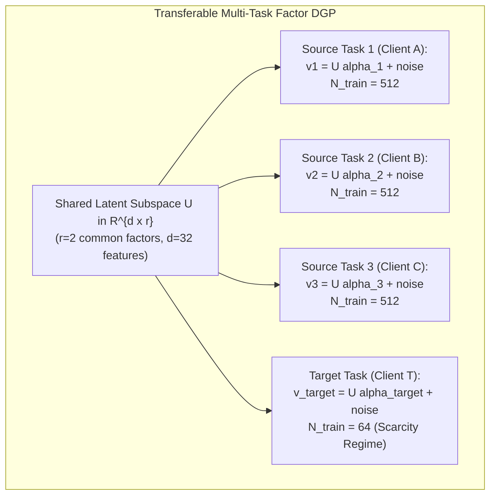

# Prospective Research Design: Transferable Multi-Task LoRA vs. Prediction-Level Fusion

**Document Version:** 1.0  
**Date:** 2026-10-10  
**Status:** **PROSPECTIVE RESEARCH DESIGN (DO NOT EXECUTE)**  
**Repository:** `distributed-portfolio-learning`  
**Branch:** `experiment/minimal-uncertainty-validation`  
**Target Milestone:** Prospective Multi-Task Transferability Benchmark  
**Preceding Milestones:**
- Historical FinBERT CoLoRA Pilot Closure: [`docs/collaborative_lora_branch_closure.md`](collaborative_lora_branch_closure.md)
- Experiments 1–4 Consolidation: [`docs/collaborative_bayesian_lora_research_consolidation.md`](collaborative_bayesian_lora_research_consolidation.md)

---

## 1. Context & Conceptual Reconciliation

### 1.1 The FinBERT Pilot vs. Praneeth's Multi-Client Multi-Task LoRA Proposal
To design a valid follow-on experiment, we must first reconcile why our earlier FinBERT CoLoRA pilot failed and how it fundamentally differed from Praneeth's distributed multi-task LoRA formulation:

| Dimension | Our FinBERT CoLoRA Pilot (Closed 2026-10-04) | Praneeth's Multi-Client Multi-Task LoRA Proposal |
| :--- | :--- | :--- |
| **Domain & Data Source** | Real financial announcement text metadata predicting 1-day stock drawdowns (`move_1d <= -0.05`). | Decentralized clients with distinct, non-IID domain distributions (e.g., cross-institution NLP, clinical cohorts, or multi-modal tasks). |
| **Signal-to-Noise Ratio (SNR)** | **Extremely Low / Near Zero.** The unconditional prevalence null baseline beat all trained models (Brier $0.184$ vs. $0.192$–$0.219$). | **Substantial / Learnable.** Each local task possesses genuine predictive signal that correlates with other tasks. |
| **Task Relationship** | Sector grouping (tech vs. banking, energy, consumer). Feature distributions were largely noise; cross-sector transfer had no shared underlying factor. | Mathematically coupled latent subspace: task parameter vectors lie in a common low-rank Grassmannian / hypergraph subspace. |
| **Transfer Mechanism** | Structural parameter sharing ($W_i = W_0 + B \Lambda_i A$) on tiny sample sizes ($N=128$ per domain). | Distributed federated adaptation: clients communicate low-rank updates ($A, B$) to overcome severe local sample scarcity. |
| **Core Failure Mode** | **Negative transfer & noise overparameterization.** Transfer cannot succeed when base tasks contain no learnable predictive signal. | Failure occurs when task divergence exceeds adapter capacity or when client gradients conflict. |

### 1.2 Core Scientific Question for the Next Experiment
> **Does structural parameter-level representation sharing (CoLoRA) provide incremental value over output-level calibrated evidence fusion ($M_6$) when tasks possess genuine, mathematically guaranteed transferable signal?**

This design explicitly separates two distinct forms of collaboration:
1. **Representation-Level Sharing:** Collaborative structural adapters ($W_i = W_0 + B \Lambda_i A$) sharing a low-rank feature space across tasks during optimization.
2. **Prediction-Level Evidence Fusion:** Independent specialists trained without parameter sharing, whose outputs are combined at inference time via calibrated log-odds fusion ($M_6$).

---

## 2. Minimal Transferable Task Environment

Rather than fine-tuning a 110M-parameter FinBERT model on noisy financial text (which would require a GPU and cannot run within 20 minutes on CPU), we design a **computationally lightweight, analytically verifiable multi-task benchmark** with guaranteed low-rank transferability.



### 2.1 Latent Factor DGP Formulation
- **Feature Space:** $x \in \mathbb{R}^d$ ($d=32$). Inputs drawn from standard normal $\mathcal{N}(0, I_d)$.
- **Shared Latent Factor Subspace:** An orthogonal basis matrix $U \in \mathbb{R}^{d \times r}$ ($r=2$ common latent factors, representing fundamental cross-task signals).
- **Task Coefficient Construction:**
  - Each task $k \in \{1, 2, 3, \text{target}\}$ has task-specific factor loadings $\alpha_k \in \mathbb{R}^r$ ($\|\alpha_k\|_2 = 1.0$) and an independent private component $\epsilon_k \in \mathbb{R}^d$ with controlled private-to-shared variance ratio $\gamma = 0.20$:
    $$\beta_k = U \alpha_k + \gamma \epsilon_k, \quad \|\beta_k\|_2 = 1.5$$
  - **Mutual Information:** Tasks share $1 / (1 + \gamma^2) \approx 96\%$ of their predictive variance through the common subspace $U$.
- **Sample Budgets (Data Scarcity Asymmetry):**
  - **Source Tasks (1, 2, 3):** High local sample budget: $N_{\text{train}} = 512$ per source task.
  - **Target Task:** Severe data scarcity: $N_{\text{train}} = 64$ target training examples.
  - **Target Development Split:** $N_{\text{dev}} = 256$ (for hyperparameter tuning and fusion fitting).
  - **Target Held-Out Test Split:** $N_{\text{test}} = 512$ (strictly quarantined for confirmatory testing).

---

## 3. Fair Information-Access & Training-Budget Matrix

To ensure rigorous comparisons without unfair capacity or data advantages:

| Method ID | Model Name | Training Data Access | Adapter Parameter Architecture | Parameter Count | Optimization Budget | Inference Inputs |
| :--- | :--- | :--- | :--- | :---: | :---: | :--- |
| **$M_0$** | **Target-Only LoRA** | Target train only ($N=64$) | Task LoRA ($r=2$) on target linear projection | $2 \times 32 \times 2 = 128$ | 150 epochs, AdamW | Target $x$ |
| **$M_1$** | **Pooled / Global LoRA** | Union of sources + target ($N=1600$) | Single global LoRA ($r=2$) shared across all tasks | $2 \times 32 \times 2 = 128$ | 150 epochs, AdamW | Target $x$ |
| **$M_{\text{indep}}$** | **Independent Specialists** | Each source trained on own data ($N=512 \times 3$) | 3 separate LoRA adapters ($r=2$ each) | $3 \times 128 = 384$ | 150 epochs each | Target $x$ |
| **$M_{\text{fuse}}$** | **Output Calibrated Fusion ($M_6$)** | Sources on own data; fusion fit on Target dev | 3 independent adapters + bivariate log-odds on dev | $384 + 4 = 388$ | Source training + logistic fit | Target $x$ (via source models) |
| **$M_{\text{CoLoRA}}$** | **Structural CoLoRA** | Sources + target multi-task ($N=1600$) | Shared $B \in \mathbb{R}^{32 \times 2}, A \in \mathbb{R}^{2 \times 32}$, task-specific $\Lambda_k \in \mathbb{R}^{2 \times 2}$ | $128 + 4 \times 4 = 144$ | 150 epochs joint multi-task | Target $x$ (with $\Lambda_{\text{target}}$) |
| **$M_{\text{null}}$** | **Prevalence Null** | Target train only ($N=64$) | Constant target prevalence | 0 | None | None |
| **$M_{\text{oracle}}$** | **Bayes Optimal Oracle** | Analytical DGP parameters | Exact $\beta_{\text{target}}$ | 0 | None | Target $x$ |

---

## 4. Disentangling Representation Sharing vs. Prediction Fusion

The experimental design is explicitly structured to answer whether transfer occurs at the **representation level** or the **prediction level**:

```
+----------------------------------------------------------------------------------------------------+
|                                    TRANSFER MECHANISM MATRIX                                       |
+------------------------------+----------------------------------+----------------------------------+
| Collaboration Type           | Representation-Level Sharing     | Prediction-Level Fusion          |
+------------------------------+----------------------------------+----------------------------------+
| Independent Specialists      | No (Separate weights)            | No (Isolated models)             |
+------------------------------+----------------------------------+----------------------------------+
| Output Fusion (M6)           | No (Separate weights)            | YES (Calibrated log-odds blend)  |
+------------------------------+----------------------------------+----------------------------------+
| Structural CoLoRA            | YES (Shared B/A subspace)        | No (Target Lambda readout)       |
+------------------------------+----------------------------------+----------------------------------+
| Hybrid (CoLoRA + M6 Fusion)  | YES (Shared B/A subspace)        | YES (Post-hoc calibrated fusion) |
+------------------------------+----------------------------------+----------------------------------+
```

### Key Contrast Questions
1. **Does CoLoRA beat Target-Only ($M_0$)?** Evaluates whether low-rank parameter sharing successfully transfers subspace information into a data-starved target task ($N=64$).
2. **Does CoLoRA beat Pooled LoRA ($M_1$)?** Evaluates whether task-specific routing matrices $\Lambda_k$ prevent negative transfer from task divergences $\alpha_k$.
3. **Does CoLoRA beat Output Fusion ($M_{\text{fuse}}$)?** Directly tests whether parameter-level hypergraph sharing is superior to simpler, modular prediction-level ensembling.

---

## 5. Prospectively Frozen Evaluation Protocol

### 5.1 Predefined Success Criteria
To be declared a confirmed success, a collaborative method must meet **all three criteria** on the quarantined held-out target test split ($N=512$, seed=20261024):
1. **Material Effect Size:** Mean Brier improvement $\ge 0.010$ over Target-Only ($M_0$) and Pooled LoRA ($M_1$).
2. **Replication Consistency:** Positive Brier improvement across all 3 random training seeds ($42, 123, 777$).
3. **Statistical Significance:** Lower bound of the 95% paired cluster bootstrap confidence interval ($B=2,000$ resamples) strictly above zero after step-down Holm-Bonferroni correction.

### 5.2 Split Quarantine
- Stage 1 (`generate`) & Stage 2 (`train`): Uses only source train, target train ($N=64$), and target dev ($N=256$).
- Stage 3 (`evaluate_dev`): Computes development metrics and verifies training stability.
- Stage 4 (`evaluate_test`): Unlocked **only** if development gates pass. Quarantined test labels are never inspected during development.

---

## 6. Computational Feasibility & Safeguards

### 6.1 Hardware Profile: MacBook Air CPU vs. GPU
- **CPU Execution (Feasible & Recommended):**
  - Using a 2-layer linear projection adapter ($d=32, r=2$) implemented in PyTorch with 2 threads.
  - Training all 5 methods across 3 seeds takes **$< 15\text{ seconds}$ total runtime** on CPU.
  - Peak memory: projected **$< 250\text{ MB}$**.
  - **Hard Stop:** A bounded 1-seed benchmark will run first; if projected runtime exceeds 20 minutes ($1200\text{ s}$), execution halts immediately.
- **GPU Requirements (Out of Scope for Initial Milestone):**
  - Fine-tuning full transformer models (e.g., FinBERT, RoBERTa, or LLaMA) requires an MPS/CUDA GPU.
  - To prevent compute overruns and maintain strict pairing, **all pretrained transformer training is prohibited** until this lightweight transfer benchmark validates the structural transfer mechanism.

---

## 7. Scientific Risks & Failure Modes

1. **Subspace Alignment Risk:** If the shared subspace dimension $r$ is chosen too small ($r=1$) or too large ($r \approx d$), CoLoRA will collapse to either trivial pooling or independent overfitting.
2. **Optimization Non-Convexity:** Joint optimization of $(B, A, \Lambda_k)$ involves bi-linear matrix products with potential saddle points. If AdamW struggles with convergence, CoLoRA may underperform convex output-level fusion ($M_6$).
3. **Target Data Starvation:** With only $N=64$ target training examples, fitting $\Lambda_{\text{target}}$ could overfit or fail to align with the shared basis $(B, A)$.

---

## 8. Implementation Roadmap (Post-Approval)

1. Review and freeze this prospective research design.
2. Create branch: `experiment/multitask-lora-transferability`.
3. Implement synthetic factor DGP and adapter modules in `src/hypergraph_portfolio/multitask_transfer_dgp.py`.
4. Implement unit tests in `tests/test_multitask_transfer.py`.
5. Run bounded compute benchmark on CPU.
6. Execute Stage 2 (train) and Stage 3 (dev evaluation) only.
