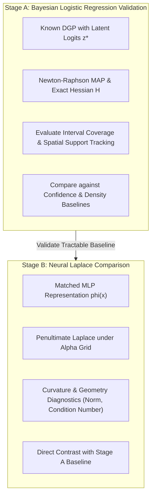

# Design Amendment: Minimal Uncertainty-Estimator Diagnostic Benchmark

**Document Version:** 1.0  
**Date:** 2026-10-10  
**Status:** **PROSPECTIVE DESIGN AMENDMENT (DIAGNOSTIC BENCHMARK)**  
**Repository:** `distributed-portfolio-learning`  
**Branch:** `experiment/minimal-uncertainty-validation`  
**Base Commit:** `599eca11`  
**Preceding Milestones:**
- Experiment 3 Closure: [`docs/bayesian_collaboration_experiment3_closure.md`](bayesian_collaboration_experiment3_closure.md)
- Initial Validation Plan: [`docs/minimal_uncertainty_validation_plan.md`](minimal_uncertainty_validation_plan.md)

---

## 1. Scope, Purpose & Epistemic Boundaries

### 1.1 Purely Diagnostic Status
This benchmark is **explicitly diagnostic** rather than a confirmatory or definitive test of all Bayesian uncertainty methods. Its purpose is to isolate why penultimate-layer Laplace approximations failed in Experiment 3 by comparing them against an analytically tractable, log-concave probabilistic baseline.

### 1.2 Non-Overstatement Safeguards
1. **No Broad Refutation:** Neither positive nor negative outcomes from this benchmark will be cited as refuting or validating Bayesian neural networks, Hamiltonian Monte Carlo, variational inference, or Bayesian deep learning generally.
2. **Specialist Collaboration Independence:** The collaborative advantage demonstrated in Experiment 2 (via static calibrated log-odds fusion, $M_6$) remains frozen and independent of whether dynamic epistemic routing succeeds or fails.
3. **No Portfolio Claims:** No claims regarding financial portfolio optimization, asset pricing, or real-world trading utility will be drawn from this synthetic diagnostic benchmark.
4. **Scope Restriction:** Full Bayesian LoRA, multi-specialist routing networks, and large-model architectures remain strictly out of scope until the fundamental uncertainty estimator is validated on small models.

---

## 2. Experimental Architecture & Predefined Hypotheses

The benchmark proceeds in two strictly sequenced diagnostic stages:

### 2.1 Stage A — Bayesian Logistic Regression (BLR) Validation
- **Model:** $p(y=1 \mid x) = \sigma(w^T x + b)$ with Gaussian prior $w \sim \mathcal{N}(0, \alpha^{-1} I)$.
- **Posterior:** Log-concave log-likelihood optimized via Newton-Raphson Iteratively Reweighted Least Squares (IRLS). Covariance $\Sigma = (X^T W X + \alpha I)^{-1}$.
- **Uncertainty Metrics:**
  - Logit scale: $\sigma_{\text{logit}}^2(x) = x^T \Sigma x$.
  - Probability scale: $\sigma_{\text{prob}}^2(x) = \hat{p}(x)(1 - \hat{p}(x))$ and probit-approximated mean $p_{\text{bayes}}(x) = \sigma\left(\frac{w_{\text{map}}^T x}{\sqrt{1 + \pi \sigma_{\text{logit}}^2 / 8}}\right)$.
- **Synthetic DGP:** Known parameters $\beta^* \in \mathbb{R}^d$ ($d=4$, $\|\beta^*\|_2 = 1.5$), intercept $b^* = 0$.
  - Training support truncated to $x_0 \in [-2, 0]$ ($N_{\text{train}} = 256$).
  - Test set spans in-support ($x_0 \in [-2, 0]$) and extrapolation support ($x_0 \in [0, 4]$, $N_{\text{test}} = 1024$).

#### Predefined Hypotheses for Stage A
- **Hypothesis H_A.1 (BLR Support Tracking):** Epistemic variance $\sigma_{\text{logit}}^2(x)$ will exhibit a positive Spearman rank correlation with Mahalanobis distance to training support ($\rho_s \ge 0.50$ across $M=20$ replications).
- **Hypothesis H_A.2 (BLR Credible Interval Coverage):** The 95% posterior credible interval $[z_{\text{map}} \pm 1.96 \sigma_{\text{logit}}(x)]$ will achieve $\ge 90\%$ empirical coverage of true latent logits $z^*(x) = x^T \beta^*$ in-support.
- **Hypothesis H_A.3 (BLR Selective Prediction):** Rejecting test instances with the highest epistemic variance will produce monotonic risk reduction on the extrapolation test set (AU-RC superiority over random abstention).

### 2.2 Stage B — Neural Penultimate-Layer Laplace Comparison
- **Model:** 2-layer MLP (hidden dimension 32, ReLU activation) matched on identical training and test splits.
- **Readout:** Penultimate representation $\phi(x) \in \mathbb{R}^{32}$. Laplace covariance on readout weights: $\Sigma_{\phi} = (\Phi^T W \Phi + \alpha I)^{-1}$.
- **Hyperprior Grid:** $\alpha \in \{0.01, 0.1, 1.0, 10.0, 100.0\}$.

#### Predefined Hypotheses for Stage B
- **Hypothesis H_B.1 (Representation Distortion):** The failure of neural Laplace support tracking ($\rho_s < 0.40$ in Exp 3) is driven by representation geometry: representation norms $\|\phi(x)\|$ do not grow monotonically with input Euclidean/Mahalanobis distance due to ReLU activation clipping.
- **Hypothesis H_B.2 (Hyperprior Sensitivity):** Optimizing prior precision $\alpha$ across the grid will not fully restore the spatial tracking performance achieved by the linear BLR baseline (gap $\ge 0.15$ in $\rho_s$).
- **Hypothesis H_B.3 (Curvature Conditioning):** The neural penultimate Hessian $H_{\phi}$ exhibits severe ill-conditioning ($\kappa(H_{\phi}) \gg \kappa(H_{\text{BLR}})$), causing variance estimates to be dominated by a few unregularized directions.

---

## 3. Positive & Negative Controls

1. **Positive Control 1 (Empirical Density Estimator):** Mahalanobis distance $d_M^2(x, \hat{\mu}, \hat{\Sigma})$ computed directly on input space. Must achieve near-perfect support tracking by construction ($\rho_s > 0.90$).
2. **Positive Control 2 (1D Canonical Extrapolation):** In 1D linear regression with known design matrix, $x^2 / \sum x_i^2$ is strictly quadratic in $|x|$. BLR must replicate this parabolic profile.
3. **Negative Control 1 (Random Noise):** Uniform random scores $\xi \sim \mathcal{U}(0, 1)$ assigned as uncertainty. Must achieve zero support tracking ($\rho_s \approx 0$) and flat risk-coverage.
4. **Negative Control 2 (Inverted Boundary Confidence):** Using $1 - |p - 0.5|$ as epistemic uncertainty. Must peak at the decision boundary rather than in data-sparse extrapolation regions.

---

## 4. Predefined Stopping Criteria & Scientific Interpretations

| Observed Outcome | Scientific Interpretation | Required Post-Benchmark Action |
| :--- | :--- | :--- |
| **Stage A passes (H_A.1 & H_A.2 confirmed), Stage B fails (H_B.1 confirmed).** | The Laplace approximation is mathematically sound, but neural feature representations fail to preserve input spatial metric geometry. | Conclude that penultimate Laplace on standard MLPs is unsuitable for spatial uncertainty routing. Recommend explicit density modeling or spectral normalization. |
| **Stage A fails (H_A.1 or H_A.2 refuted).** | The mathematical definition of spatial support tracking or the Laplace approximation itself fails even on log-concave models. | Re-examine the theoretical foundations of the evaluation metrics; do not blame neural network depth. |
| **Stage B passes under optimal $\alpha^*$.** | The Exp 3 gate failure was purely an artifact of fixed $\alpha = 1.0$ mis-specification. | Update neural routing protocol to incorporate Empirical Bayes prior precision tuning. |
| **Neither BLR nor Neural improves selective risk (AU-RC flat).** | Epistemic uncertainty does not predict error reduction under this covariate structure. | Halt dynamic uncertainty routing entirely; consolidate on static calibrated log-odds fusion ($M_6$). |

---

## 5. Compute Safeguards & Experimental Budget

- **Hardware:** CPU only, strictly capped at 2 PyTorch threads (`torch.set_num_threads(2)`).
- **Dataset Replications:** $M = 20$ independent training datasets ($N_{\text{train}} = 256$, seeds $101, \dots, 120$).
- **Bounded Benchmark:** A 1-seed benchmark will run first to measure actual latency and peak memory before launching the 20 replications.
- **Runtime Guardrail:** If the bounded benchmark projects full runtime $> 20$ minutes ($1200\text{ s}$), execution is halted immediately. Expected runtime is $< 60\text{ seconds}$.
- **Peak Memory Guardrail:** Projected memory $< 350\text{ MB}$. Hard limit $4000\text{ MB}$.
- **GP & MCMC Status:** Gaussian Process and MCMC baselines remain optional. They will be invoked only if Stage A and Stage B yield scientifically ambiguous contrasts.

---
