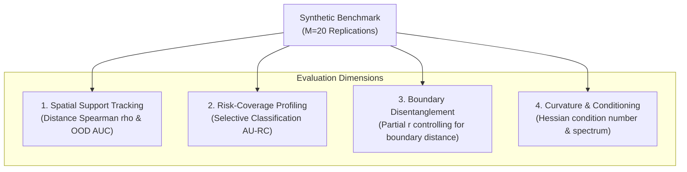

# Prospective Research Plan: Minimal Uncertainty-Estimator Validation

**Document Version:** 1.0  
**Date:** 2026-10-10  
**Status:** **PROSPECTIVE RESEARCH PLAN (DO NOT EXECUTE)**  
**Target Repository:** `distributed-portfolio-learning`  
**Target Branch:** `experiment/minimal-uncertainty-validation` (to be created upon approval)  
**Preceding Milestone:** Experiment 3 Closure ([`docs/bayesian_collaboration_experiment3_closure.md`](bayesian_collaboration_experiment3_closure.md))

---

## 1. Context & Motivation

In Experiment 3, a penultimate-layer Laplace approximation on small ReLU multi-layer perceptrons failed development gates U1 (support sparsity tracking $\rho_s < 0.40$) and U2 (residual error partial correlation $r < 0.10$, observed negative). Furthermore, feeding these variance estimates to learned routers yielded negligible predictive gain ($+0.0001$ to $+0.0011$ Brier) over routing without uncertainty features.

Before investing in full Bayesian LoRA, multi-specialist collaborative routing, or larger neural architectures, we must isolate whether the fundamental uncertainty estimator itself possesses sound epistemic properties in a minimal, analytically grounded benchmark.

### Core Research Questions
1. Does an analytically tractable Bayesian model (e.g., Bayesian Logistic Regression) reliably produce epistemic variance that tracks spatial support sparsity and enables effective sample abstention?
2. Why does the neural penultimate-layer Laplace readout fail these criteria, and can hyperparameter tuning (prior precision $\alpha$, Generalized Gauss-Newton vs. Empirical Fisher) rectify it?
3. Does epistemic uncertainty provide distinct, non-redundant information when rigorously separated from predictive entropy and aleatoric uncertainty?

---

## 2. Models & Estimators Under Comparison

The benchmark compares three well-defined estimators of increasing complexity on identical synthetic datasets:

### 2.1 Model 1: Analytically Tractable Bayesian Logistic Regression (BLR)
- **Architecture:** Linear logistic model $p(y=1 \mid x) = \sigma(w^T x + b)$.
- **Prior:** Zero-mean isotropic Gaussian $w \sim \mathcal{N}(0, \alpha^{-1} I)$.
- **Posterior Properties:** Negative log-likelihood is globally convex:
  $$H = \nabla^2 (-\log p(w \mid \mathcal{D})) = X^T W X + \alpha I, \quad W_{ii} = p_i (1 - p_i)$$
  The Laplace approximation is exact in curvature at the mode (MAP found via deterministic Newton-Raphson / IRLS).
- **Gold-Standard Comparison:** 1,000 Pólya-Gamma Gibbs samples or Metropolis-Hastings MCMC draws to evaluate posterior approximation fidelity.
- **Epistemic Variance:** $\sigma_{\text{epistemic}}^2(x) = x^T H^{-1} x$.

### 2.2 Model 2: Neural Penultimate-Layer Laplace Readout (Exp 3 Setting)
- **Architecture:** 2-layer MLP (hidden dimension 32, ReLU activation) with linear readout:
  $$f(x) = w^T \phi(x) + b$$
- **Laplace Formulation:** Hessian of readout weights evaluated on training representations $\Phi = \phi(X_{\text{train}})$:
  $$H_{\phi} = \Phi^T W \Phi + \alpha I$$
- **Evaluated Variants:**
  - Variant 2a: Fixed isotropic prior $\alpha = 1.0$ (Experiment 3 frozen setting).
  - Variant 2b: Empirical Bayes optimized prior precision $\alpha^*$ via evidence / marginal likelihood maximization.
  - Variant 2c: Generalized Gauss-Newton (GGN) vs. Empirical Fisher curvature approximation.
- **Epistemic Variance:** $\sigma_{\text{epistemic}}^2(x) = \phi(x)^T H_{\phi}^{-1} \phi(x)$.

### 2.3 Model 3: Gaussian Process Binary Classifier (GPBC - Spatial Reference)
- **Architecture:** GP with radial basis function (RBF) kernel $k(x, x') = \sigma_f^2 \exp(-\frac{\|x - x'\|^2}{2 \ell^2})$.
- **Posterior:** Exact spatial extrapolation property: as $x$ moves far from training points, predictive variance strictly reverts to the prior kernel variance $\sigma_f^2$.
- **Epistemic Variance:** Latent function posterior variance $\mathbb{V}[f(x) \mid \mathcal{D}]$.

---

## 3. Disentangling Uncertainty Types

To avoid conflating distinct uncertainty sources, the benchmark defines and records three separate quantities for every test observation $x$:

1. **Epistemic Uncertainty ($\sigma_{\text{epistemic}}^2$):**
   $$\sigma_{\text{epistemic}}^2(x) = \mathbb{V}_{\theta \sim p(\theta \mid \mathcal{D})}[f_{\theta}(x)]$$
   Measures parameter ignorance due to lack of training data. Must be large in support-sparse or out-of-distribution regions.

2. **Aleatoric Uncertainty ($\sigma_{\text{aleatoric}}^2$):**
   $$\sigma_{\text{aleatoric}}^2(x) = \hat{p}(x)(1 - \hat{p}(x)), \quad \text{where } \hat{p}(x) = \mathbb{E}_{\theta}[\sigma(f_{\theta}(x))]$$
   Measures intrinsic label noise at the expected prediction. Maximized at the decision boundary ($\hat{p} \approx 0.5$) regardless of sample density.

3. **Predictive Entropy ($H[\hat{p}]$):**
   $$H[\hat{p}(x)] = -\hat{p}(x) \log \hat{p}(x) - (1 - \hat{p}(x)) \log (1 - \hat{p}(x))$$
   Total predictive dispersion, combining epistemic spread and aleatoric ambiguity.

---

## 4. Multi-Faceted Evaluation Protocol

Rather than relying on a single correlation threshold that can be distorted by boundary noise, the benchmark evaluates four orthogonal dimensions:

### 4.1 Spatial Support Tracking
- **Dataset Design:** $N_{\text{train}} = 256$ drawn from localized support $\mathcal{X}_{\text{train}} = \{x \in \mathbb{R}^d : x_0 \in [-2, 0]\}$.
- Test set ($N_{\text{test}} = 1024$) spans in-support, boundary, and extrapolation regimes ($x_0 \in [-4, 4]$).
- **Metric 1.1:** Spearman rank correlation $\rho_s(\sigma_{\text{epistemic}}^2(x), d_M(x, \mathcal{X}_{\text{train}}))$ with Mahalanobis distance to training support.
- **Metric 1.2:** AUROC for separating in-support vs. out-of-support points using $\sigma_{\text{epistemic}}^2(x)$.

### 4.2 Selective Classification / Risk-Coverage Profiling
- Rank test observations by increasing epistemic uncertainty $\sigma_{\text{epistemic}}^2(x)$.
- Compute selective risk (Brier score or error rate) as coverage varies from $100\%$ down to $20\%$.
- **Metric 2.1:** Area Under Risk-Coverage curve (AU-RC). A valid uncertainty estimator must achieve monotonic risk reduction as uncertain points are rejected.

### 4.3 Boundary-Noise Disentanglement
- Partial correlation $r(\sigma_{\text{epistemic}}^2, (p - y)^2 \mid |p - 0.5|)$ evaluated separately inside training support vs. outside training support.
- Verifies whether epistemic uncertainty isolates model ignorance without being dominated by aleatoric boundary misclassifications.

### 4.4 Curvature & Conditioning Diagnostics
- Hessian condition number $\kappa(H) = \lambda_{\max}(H) / \lambda_{\min}(H)$.
- Eigenspectrum decay rate and effective dimensionality $d_{\text{eff}} = \sum_i \frac{\lambda_i}{\lambda_i + \alpha}$.
- Representation norm ratio $\frac{\|\phi(x_{\text{OOD}})\|}{\|\phi(x_{\text{ID}})\|}$ to detect feature collapse or ReLU saturation.

---

## 5. Experimental Replications & Statistical Plan

- **Monte Carlo Replications:** $M = 20$ independent dataset draws (seeds $101, \dots, 120$) to compute mean metrics and 95% confidence intervals.
- **Synthetic Input Dimension:** $d = 4$ shared features, generating non-trivial covariance without high-dimensional sparsity artifacts.
- **Target Distribution:** Logistic Bernoulli with controlled signal-to-noise ratio:
  $$p^*(x) = \sigma(\beta^T x), \quad \|\beta\|_2 = 1.5$$

---

## 6. Pre-Specified Stopping Criteria & Failure Interpretations

| Diagnostic Outcome | Interpretation | Prescribed Research Decision |
| :--- | :--- | :--- |
| **BLR passes ($\rho_s \ge 0.60$, OOD-AUC $\ge 0.85$); Neural Laplace fails ($\rho_s < 0.40$).** | The Laplace algorithm is sound; the failure is caused by neural representation geometry (ReLU saturation, feature collapse). | Abandon penultimate Laplace on standard MLPs. Investigate explicit density estimation (GMM/Mahalanobis) or spectral-normalized representations. |
| **Neural Laplace with tuned $\alpha^*$ passes ($\rho_s \ge 0.50$); fixed $\alpha=1.0$ fails.** | The failure in Exp 3 was a hyperprior mis-specification artifact. | Adopt Empirical Bayes prior tuning in future neural routing experiments. |
| **All models (BLR, GP, Neural) fail spatial tracking ($\rho_s < 0.40$).** | The spatial correlation metric or synthetic DGP geometry is fundamentally flawed for measuring epistemic uncertainty. | Revise the mathematical definition of spatial support metric; do not attribute to model architecture. |
| **Epistemic uncertainty does not improve selective risk (AU-RC flat or negative).** | Epistemic uncertainty does not predict error reduction under this covariate structure. | Halt uncertainty-weighted routing entirely; retain static calibrated log-odds fusion ($M_6$). |

---

## 7. Execution Guardrails & Resource Budget

- **Hardware:** CPU only, strictly capped at 2 PyTorch threads.
- **Compute Time:**
  - Newton-Raphson BLR: $\approx 5\text{ ms}$ per fit $\times 20$ replications $\approx 0.1\text{ s}$.
  - Small MLP training: $\approx 0.15\text{ s}$ per fit $\times 20$ replications $\approx 3.0\text{ s}$.
  - GP baseline: $\approx 0.5\text{ s}$ per fit $\times 20$ replications $\approx 10.0\text{ s}$.
  - Total estimated runtime: **$< 30\text{ seconds}$** (well below the 20-minute ceiling).
- **Peak Memory:** Projected $< 300\text{ MB}$.
- **Guardrail:** Any execution exceeding 20 minutes triggers mandatory termination.
- **Scope Restriction:** **Zero** large-model or full Bayesian LoRA training permitted under this benchmark.

---

## 8. Implementation Roadmap (Post-Approval)

1. Review and approve this research plan.
2. Branch creation: `experiment/minimal-uncertainty-validation`.
3. Implement `src/hypergraph_portfolio/minimal_uncertainty_benchmark.py`.
4. Implement corresponding unit tests in `tests/test_minimal_uncertainty_benchmark.py`.
5. Execute benchmark across $M=20$ replications.
6. Commit scientific findings and determine whether Bayesian routing can be revived or formally abandoned.
