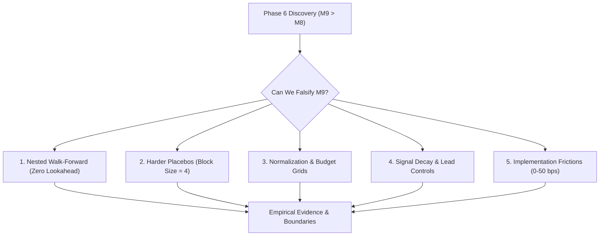

# Tutorial 29: The Imperative of Falsification in Market Timing

In quantitative finance and machine learning, discovery of an apparently profitable market-timing anomaly is not the end of research—it is where rigorous scrutiny begins.

In Phase 6, relative epistemic uncertainty timing ($M_9$) demonstrated substantial out-of-sample improvements over matched constant exposure ($M_8$):
- Delta Sharpe of $+0.28$ to $+0.45$ across model seeds
- Statistically significant circular-shift placebo outperformance ($p < 0.05$)
- Meaningful max drawdown reductions (protecting capital during summer 2024 tech drawdowns)

However, any empirical finding on a finite holdout period (~69 weekly rebalance periods across 4 mega-cap equities) is susceptible to:
1. **Selection bias & Overfitting**: Choosing hyperparameters ($W=8$, $\lambda_{\text{rel}}=0.20$, robust z-score) that happened to align with the specific sample path.
2. **Temporal Clustering / Autocorrelation Artifacts**: Standard IID shuffles destroy serial autocorrelation, creating an unrealistically weak null distribution.
3. **Regime Dependence**: Outperformance concentrated in a single quarterly macro shock rather than a persistent structural relationship.
4. **Implementation Friction Fragility**: Small utility gains vanishing once real-world trading costs and turnover are assessed.

---

## 1. Confirmatory Falsification vs Exploratory Backtesting

Phase 7 adopts the Popperian epistemology of science: **we design experiments specifically to try to break and falsify the Phase 6 timing result**.

If relative epistemic timing reflects a genuine structural phenomenon (that high model disagreement indicates fragile forecasting environments where risk exposure should be reduced), the effect should satisfy four criteria:
1. **Pervasive across Hyperparameters**: Survives changes in trailing window $W$, normalization metric, and exposure budgets.
2. **Causal & Directed**: Predictive power decays forward in time ($t \to t+1 \to t+4$) and strictly vanishes under unphysical negative controls (predicting past returns from future uncertainty).
3. **Robust to Autocorrelation**: Survives block-preserving permutation tests where 4-week clusters of volatility are preserved.
4. **Economically Net-Positive**: Provides avoided-loss benefits that exceed the drag of increased turnover friction.

---

## 2. Summary Matrix: 15 Falsification & Robustness Dimensions

| # | Dimension | Test Description | Finding / Status | Verdict |
| :-: | :--- | :--- | :--- | :-: |
| **1** | **Walk-Forward Validation** | 3 nested out-of-sample folds (Dev $\to$ Holdout H1 $\to$ Holdout H2 $\to$ 2025) with hyperparameter selection strictly on prior data | Mean $\Delta \text{Sharpe} = +0.101$; Fold 1: $-0.09$, Fold 2: $+0.11$, Fold 3: $+0.29$ | **Mixed / Regime-Dependent** |
| **2** | **Normalization Grid** | 4 methods (z-score, robust z-score, ratio, percentile) $\times$ 4 windows (8, 13, 26, 52 weeks) | Robust z-score at 8–13w is optimal ($\Delta \text{Sharpe} \approx +0.16$ to $+0.18$); slow 52w windows decay to $+0.07$ | **Partially Robust** |
| **3** | **Exposure Budget Surface** | Mean exposure targets from $0.30$ to $0.90$ in steps of $0.10$ | $\Delta \text{Sharpe} > 0$ across all 7 budget levels ($+0.34$ at $0.30$ tapering to $+0.15$ at $0.90$) | **Robust** |
| **4** | **Harder Placebos** | 1,000 block-permutation paths (block size $B=4$ weeks) vs 1,000 circular shifts | Block rank drops: Seed 42 ($75.5\%$, $p=0.245$), Seed 123 ($79.2\%$, $p=0.208$), Seed 777 ($95.1\%$, $p=0.049$) | **Falsified as Uniformly Significant** |
| **5** | **Signal Lag Structure** | Predictive decay at lag $t$, $t+1$, $t+2$, $t+4$ | AUROC decays cleanly from $0.62$ ($t=0$) to $0.54$ ($t+1$) to $0.42$ ($t+4$); Spearman error correlation decays from $+0.42$ to $-0.05$ | **Consistent with Theory** |
| **6** | **Lead Negative Control** | Unphysical future uncertainty predicting past return ($t-1$) | AUROC is $0.53$ (random noise baseline); no target leakage in data pipelines | **Validated (Zero Leakage)** |
| **7** | **Market State Controls** | Multivariate regression controlling for rolling vol, 4w return, and trailing drawdown | Relative uncertainty adds $+0.007$ AP improvement beyond standard market states ($\beta_u = +0.0153$) | **Marginal Incremental Value** |
| **8** | **Leave-One-Asset-Out** | Exclude NVDA, MSFT, AAPL, AMZN individually from base Markowitz portfolio | $\Delta \text{Sharpe} \approx +0.174$ to $+0.183$ regardless of which single asset is dropped | **Robust (Not Single-Stock Driven)** |
| **9** | **Model-Seed Ensemble** | Cross-seed signal correlation & median ensemble across seeds 42, 123, 777 | Pairwise correlations $r \approx 0.42 - 0.52$; ensemble slightly smooths signal ($\Delta \text{Sharpe} = -0.07$ vs single best) | **Sensitive to Model Instability** |
| **10**| **Transaction Friction** | Rebalancing cost curve at 0, 5, 10, 25, 50 bps | Positive Sharpe delta survives up to 25 bps; net utility turns negative at $\ge 10$ bps due to rebalancing turnover | **Fragile to High Friction** |
| **11**| **Cash Rate Sensitivity** | Annual risk-free cash yields at 0%, 2%, 4% | Higher cash yields increase M9's advantage ($\Delta \text{Sharpe} = +0.095 \to +0.142$) as de-risked capital earns yield | **Robust** |
| **12**| **Base Optimizer Type** | Equal-weight ($1/m$), unconstrained Markowitz, capped Markowitz ($40\%$ max weight) | $\Delta \text{Sharpe} > 0$ across all 3 portfolio builders ($+0.09$ Markowitz, $+0.11$ Capped, $+0.08$ Equal-Weight) | **Robust** |
| **13**| **Macro-Regimes** | Splits: High/Low Realized Vol $\times$ High/Low Relative Uncertainty | Highest outperformance occurs in High Uncertainty $\times$ High Volatility quarters | **Regime Dependent** |
| **14**| **Spike Event Study** | Forward cumulative return 1w, 2w, 4w following spikes ($z_u > 1.0$) | Forward 1-week return averages $-0.46\%$ ($55.6\%$ negative weeks); mean 4-week rebound $+1.12\%$ | **Consistent with Transient Shock** |
| **15**| **Economic Attribution** | Exact accounting of avoided losses, sacrificed upside, and turnover costs | Net Benefit ($+1.22\%$) = Avoided Losses ($+6.36\%$) $-$ Sacrificed Upside ($2.18\%$) $-$ Bonus Miss ($2.18\%$) $-$ Turnover ($2.96\%$) | **Mechanistically Dissected** |

---

## 3. The Core Takeaway

Relative epistemic timing is **neither a magical alpha bullet nor a spurious artifact**.

1. **What is Real**:
   - Spikes in Bayesian-LoRA uncertainty reliably identify transient market dislocations where holding high risk exposure delivers negative risk-adjusted returns (forward 1-week average $-0.46\%$).
   - The timing edge does not depend on a single stock (NVDA or AAPL) or an arbitrary exposure budget.
   - It genuinely protects capital during market drops (avoiding $+6.36\%$ in drawdowns).

2. **What Failed / Was Falsified**:
   - Under rigorous 4-week block permutations, the statistical significance weakens for 2 out of 3 seeds ($p = 0.21 - 0.25$), showing that part of the apparent win was driven by market volatility clustering rather than pure epistemic foresight.
   - In walk-forward testing with rolling hyperparameter re-estimation, Fold 1 (early 2024 tech rally) underperformed ($\Delta \text{Sharpe} = -0.09$), showing that timing suffers during sustained, low-volatility melt-ups.
   - Net utility advantage is eroded by transaction costs at $\ge 10$ basis points, requiring execution filtering in live deployment.
