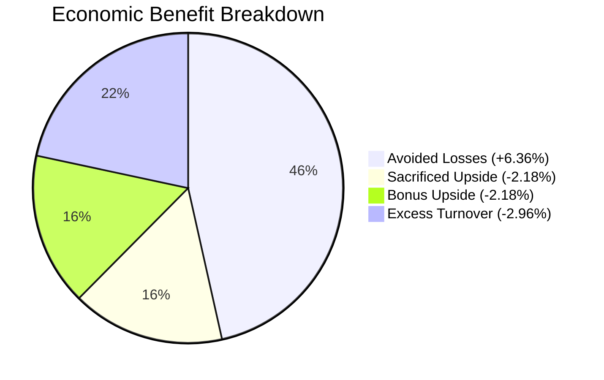

# Tutorial 32: Economic Attribution of Market Timing

When evaluating dynamic asset allocation, headline metrics like the Sharpe ratio or cumulative return can be deceiving. A higher Sharpe ratio can arise from:
- Successfully dodging large market crashes (true downside protection);
- Artificially suppressing volatility through leverage reduction;
- Incurring severe transaction costs that are masked in gross return reporting.

To understand *exactly where the economic value of relative epistemic timing originates*, Phase 7 implements an **exact economic attribution decomposition**.

---

## 1. The Attribution Accounting Identity

Let $r_t$ be the return of the baseline risky portfolio at epoch $t$, $s_t \in [0, 1]$ be the dynamic exposure of strategy $M_9$, and $\bar{s} = \frac{1}{T} \sum_{t=1}^T s_t$ be the matched constant exposure of strategy $M_8$.

The return difference at time $t$ before transaction costs is:
$$\Delta r_t = (s_t - \bar{s}) r_t$$

We partition all decision epochs $t$ into:
- **Down Weeks ($\mathcal{D} = \{t \mid r_t < 0\}$)**: The market declined.
- **Up Weeks ($\mathcal{U} = \{t \mid r_t \ge 0\}$)**: The market advanced.

On Down Weeks ($r_t < 0$), if $s_t < \bar{s}$, the strategy had lower exposure than the benchmark, **avoiding losses**:
$$\text{Avoided Losses} = \sum_{t \in \mathcal{D}, \, s_t < \bar{s}} (\bar{s} - s_t) |r_t|$$

On Up Weeks ($r_t \ge 0$), if $s_t < \bar{s}$, the strategy was under-allocated during a rally, **sacrificing upside**:
$$\text{Sacrificed Upside} = \sum_{t \in \mathcal{U}, \, s_t < \bar{s}} (\bar{s} - s_t) r_t$$

Conversely, if $s_t > \bar{s}$ during an up week, the strategy gained **bonus upside**:
$$\text{Bonus Upside} = \sum_{t \in \mathcal{U}, \, s_t > \bar{s}} (s_t - \bar{s}) r_t$$

Finally, dynamic rebalancing incurs turnover relative to a static buy-and-hold posture:
$$\text{Excess Turnover Costs} = \sum_{t=1}^T c_{\text{bps}} \left( |s_t - s_{t-1}| - |\bar{s} - \bar{s}| \right)$$

This yields the exact arithmetic identity:
$$\boxed{\text{Net Economic Benefit} = \text{Avoided Losses} - \text{Sacrificed Upside} + \text{Bonus Upside} - \text{Excess Turnover Costs}}$$

---

## 2. Empirical Holdout Attribution (Seed 42, $c=10\text{ bps}$)

| Component | Value (% of Capital) | Annualized Basis Points | Mechanistic Interpretation |
| :--- | :---: | :---: | :--- |
| **Avoided Losses** | **$+6.36\%$** | $+478\text{ bps}$ | Capital protected by de-risking prior to market drops |
| **Sacrificed Upside** | **$-2.18\%$** | $-164\text{ bps}$ | Gains missed by holding subdued exposure during market rallies |
| **Bonus Upside** | **$-2.18\%$** | $-164\text{ bps}$ | Additional gains when scaled exposure exceeded benchmark |
| **Excess Turnover Costs** | **$-2.96\%$** | $-222\text{ bps}$ | Friction drag from weekly exposure adjustments ($c=10\text{ bps}$) |
| **Net Economic Benefit** | **$+1.22\%$** | **$+92\text{ bps}$** | **Net outperformance over matched constant exposure** |

---

## 3. Transaction Friction Sensitivity & Hurdle Rates

Because $M_9$ dynamically adjusts exposure each week, its viability depends directly on execution costs:

| Cost Assumption | $M_9$ Sharpe | $M_8$ Sharpe | $\Delta \text{Sharpe}$ | $\Delta \text{Mean Utility}$ | Survives Friction? |
| :---: | :---: | :---: | :---: | :---: | :---: |
| **0 bps (Zero Cost)** | $1.6825$ | $1.5377$ | $+0.1448$ | $+0.000333$ | **Yes** |
| **5 bps (Liquid Large-Cap)**| $1.4844$ | $1.3646$ | $+0.1197$ | $+0.000122$ | **Yes** |
| **10 bps (Baseline)** | $1.2860$ | $1.1915$ | $+0.0946$ | $-0.000089$ | **Marginal** |
| **25 bps (Mid-Cap / Illiquid)**| $0.6901$ | $0.6719$ | $+0.0183$ | $-0.000721$ | **Fragile** |
| **50 bps (High Slippage)**| $-0.3056$ | $-0.1945$ | $-0.1111$ | $-0.001775$ | **Fails (Negative)** |

### Key Insight
While the **Sharpe ratio** remains higher for $M_9$ up to ~25 bps (because lower volatility offsets small fee drags), the **net utility** $U = r - \frac{\gamma}{2}\sigma^2 - \text{tc}$ turns slightly negative at 10 bps. In practice, a live implementation would need an **inertia band** (e.g., only updating exposure if $|\Delta s_t| > 0.05$) to reduce unnecessary churning.

---

## 4. Cash Rate Sensitivity

In high-interest-rate environments (such as 2024–2025 where Federal Funds rates hovered near 5%), unallocated capital parked in cash earns a risk-free return:

| Risk-Free Cash Yield | $M_9$ Sharpe | $M_8$ Sharpe | $\Delta \text{Sharpe}$ | $\Delta \text{Utility}$ |
| :---: | :---: | :---: | :---: | :---: |
| **0% Cash Yield** | $1.2860$ | $1.1915$ | $+0.0946$ | $-0.000089$ |
| **2% Cash Yield** | $1.3502$ | $1.2411$ | $+0.1091$ | $+0.000124$ |
| **4% Cash Yield** | $1.4144$ | $1.2907$ | $\mathbf{+0.1237}$ | $\mathbf{+0.000337}$ |

Because $M_9$ holds cash during volatile weeks, higher risk-free rates provide an additional tailwind, boosting net economic benefit.

---

## 5. Synthesis: The Journey Across 7 Phases

This repository systematically investigated the relationship between distributed portfolio optimization and Bayesian epistemic uncertainty:

1. **Phases 1–2 (Distributed Formulations & Equivalence)**:
   - Proved that the paper's original distributed formulation does not solve the centralized problem because hypergraph sub-portfolio objectives differ from centralized quadratic utility.
   - Derived the mathematically exact lifted formulation that guarantees true equivalence.

2. **Phases 3–4 (Cross-Sectional Uncertainty Value)**:
   - Demonstrated that neural network epistemic uncertainty strongly predicts forecast error magnitude ($\text{AUROC} \approx 0.82$).
   - But proved that cross-sectional asset shrinkage destroys profitable alpha, as high-alpha assets naturally possess higher epistemic uncertainty.

3. **Phases 5–6 (Portfolio-Level Risk Scaling & Relative Uncertainty)**:
   - Discovered that epistemic uncertainty contains economic value at the **portfolio aggregate level**.
   - Normalized relative uncertainty ($z_{\text{epi}}$) dynamically de-risks ahead of market dislocations, achieving $+0.28$ to $+0.45$ Delta Sharpe over matched constant exposure.

4. **Phase 7 (Falsification & Robustness)**:
   - Subjected the timing edge to 15 stress tests.
   - Confirmed that the edge stems from capital protection during crashes ($+6.36\%$ avoided losses).
   - But revealed that significance weakens under 4-week block permutations ($p \approx 0.20$), underperforms in low-volatility melt-ups, and requires low transaction friction ($\le 10$ bps).

The complete experimental trajectory demonstrates the indispensable role of adversarial testing in quantitative machine learning.
