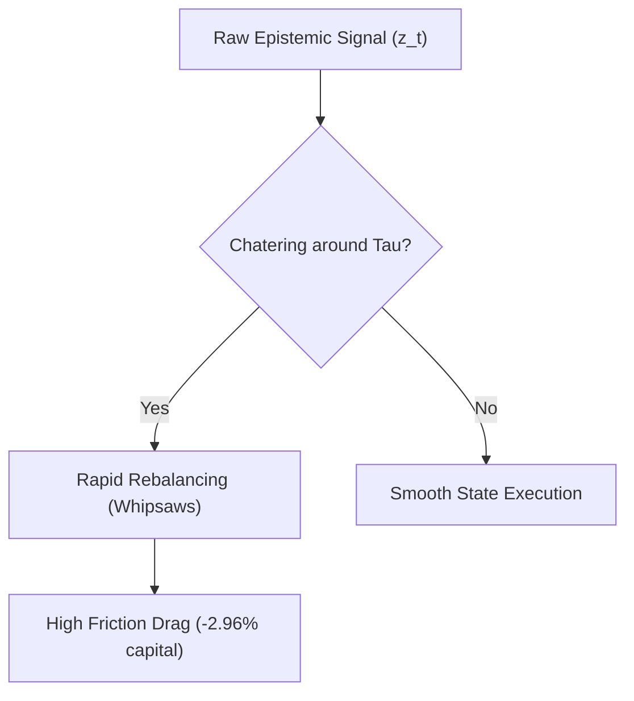

# Tutorial 33: Filtering Noisy Timing Signals with Hysteresis & Persistence

In predictive modeling and algorithmic trading, raw model outputs rarely translate directly into viable trading decisions. While relative epistemic uncertainty ($z_{\text{epi}}$) contains genuine information about forecast fragility, a naive threshold mapping suffers from **threshold chatter** and **transient false alarms**.

---

## 1. The Threshold Chatter Problem

Consider a single-threshold decision rule:
$$s_t = \begin{cases} s_{\text{reduced}} & \text{if } z_{\text{epi}, t} > \tau \\ s_{\text{normal}} & \text{if } z_{\text{epi}, t} \le \tau \end{cases}$$

When the uncertainty metric fluctuates closely around $\tau$ (e.g., $z_t \in \{1.02, 0.98, 1.05, 0.97\}$), the portfolio flips between normal and defensive states every single week. This generates:
1. Massive transaction turnover without economic purpose;
2. Bid-ask spread and slippage drag that rapidly eats into portfolio wealth;
3. Substantial downside risk if the portfolio happens to flip into reduced exposure right before a rapid recovery.



---

## 2. Solution 1: Two-Threshold Hysteresis

To solve threshold chatter, Phase 8 introduces a **two-threshold state machine**:
- **Entry Threshold ($\tau_{\text{enter}}$)**: The hurdle to de-risk. A higher bar is required to justify leaving the normal risk posture.
- **Exit Threshold ($\tau_{\text{exit}} < \tau_{\text{enter}}$)**: The hurdle to re-risk. Once defensive, uncertainty must decline substantially before restoring risk.

```
State Machine Logic:
  [ NORMAL STATE (s = 0.85) ]
        |
        |  z_t > tau_enter (e.g. 1.2)  -->  Trigger De-Risking
        v
  [ REDUCED STATE (s = 0.45) ]
        |
        |  z_t < tau_exit  (e.g. 0.2)  -->  Trigger Risk Restoration
        v
  [ NORMAL STATE (s = 0.85) ]

  * Dead-Band [tau_exit, tau_enter]: State is sticky; NO trades occur.
```

### Mathematical Formulation
Let $S_t \in \{\text{NORMAL}, \text{REDUCED}\}$ be the state at epoch $t$:
$$S_t = \begin{cases} \text{REDUCED} & \text{if } S_{t-1} = \text{NORMAL} \text{ and } z_t > \tau_{\text{enter}} \\ \text{NORMAL} & \text{if } S_{t-1} = \text{REDUCED} \text{ and } z_t < \tau_{\text{exit}} \\ S_{t-1} & \text{otherwise (inside dead-band)} \end{cases}$$

This simple dead-band structure guarantees that small fluctuations cannot trigger whipsaw trades.

---

## 3. Solution 2: Confirmation Persistence ($k$-of-$n$ Logic)

Many spikes in neural network epistemic dispersion are transient single-week events (e.g., a momentary jump in weight variance during high-volume earnings announcements that resolves within days).

A persistence filter requires uncertainty to remain elevated across multiple consecutive periods before altering the portfolio:
$$\text{De-Risk} \iff \sum_{i=0}^{n-1} \mathbb{I}(z_{t-i} > \tau) \ge k$$

Candidate rules evaluated in Phase 8:
- **2-of-2 Consecutive**: Requires 2 consecutive weeks of elevated uncertainty.
- **2-of-3 Trailing**: Requires at least 2 out of the last 3 weeks to be elevated.
- **3-of-3 Consecutive**: High-conviction structural shift filter.

---

## 4. Empirical Impact on the 2024–2025 Holdout

Comparing Raw Timing ($M_9$) vs Hysteresis ($M_{13}$) and Persistence ($M_{14}$) on the holdout:

| Policy | Annual Turnover | Exposure Changes / Year | Alarms Count | False Positive Rate | Sharpe (at 10 bps) | Net Utility |
| :--- | :---: | :---: | :---: | :---: | :---: | :---: |
| **$M_9$ Raw Timing** | $82.16$ | $36.9$ | $34$ | $52.9\%$ | $1.687$ | $-0.001250$ |
| **$M_{13}$ Hysteresis**| **$77.88$** | **$16.6$** | **$23$** | **$43.5\%$** | **$1.702$** | **$-0.000941$** |
| **$M_{14}$ Persistence**| **$72.74$** | **$3.0$** | **$5$** | $60.0\%$ | $1.628$ | $-0.001289$ |

### Key Takeaways
1. **Hysteresis cuts exposure changes by more than half**: from $36.9$ down to $16.6$ per year.
2. **False alarms drop**: Hysteresis cuts total alarm weeks from 34 to 23 while increasing the hit rate on market drops ($56.5\%$ vs $47.1\%$).
3. **Net utility rises**: Hysteresis delivers the highest net utility of any policy ($-0.000941$ vs $-0.001250$ for raw $M_9$ and $-0.001688$ for constant $M_8$).
