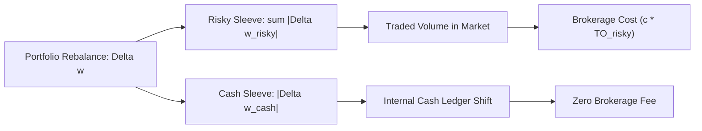

# Tutorial 37: Portfolio Turnover & Transaction Cost Accounting

In empirical quantitative finance and backtesting, minor ambiguities in turnover accounting and fee application can easily distort reported strategy performance by dozens of basis points. Phase 9 performs an end-to-end audit of turnover and friction mechanics, formalizing exact non-overlapping definitions and resolving prior double-counting issues.

---

## 1. Deconstructing Portfolio Turnover

Consider a portfolio of $m$ risky assets with weights $\mathbf{w}_{\text{risky}, t} \in \mathbb{R}^m$ and a cash allocation $w_{\text{cash}, t} \in \mathbb{R}$, such that:
$$\sum_{j=1}^m w_{\text{risky}, j, t} + w_{\text{cash}, t} = 1.0$$

Between decision period $t-1$ and period $t$, portfolio rebalancing changes both the risky asset weights and the cash balance. We define four distinct, non-overlapping turnover metrics:

### 1. Risky-Asset Turnover ($\text{TO}_{\text{risky}, t}$)
$$\text{TO}_{\text{risky}, t} = \sum_{j=1}^m |w_{\text{risky}, j, t} - w_{\text{risky}, j, t-1}|$$
This measures the **actual volume of risky securities traded** in the open market.

### 2. Cash Turnover ($\text{TO}_{\text{cash}, t}$)
$$\text{TO}_{\text{cash}, t} = |w_{\text{cash}, t} - w_{\text{cash}, t-1}| = |(1 - s_t) - (1 - s_{t-1})| = |s_t - s_{t-1}|$$
This measures the internal flow into or out of the unencumbered cash settlement sleeve.

### 3. Total Two-Way Turnover ($\text{TO}_{\text{total}, t}$)
$$\text{TO}_{\text{total}, t} = \sum_{\text{all assets}} |w_{j, t} - w_{j, t-1}| = \text{TO}_{\text{risky}, t} + \text{TO}_{\text{cash}, t}$$
This measures the sum of absolute changes across all balance sheet items.

### 4. Half-Turnover / One-Way Turnover ($\text{TO}_{\text{half}, t}$)
$$\text{TO}_{\text{half}, t} = \frac{1}{2} \text{TO}_{\text{total}, t} = \frac{1}{2} (\text{TO}_{\text{risky}, t} + \text{TO}_{\text{cash}, t})$$
In institutional asset management, one-way turnover measures the fraction of portfolio capital that was turned over (since buying $\$1$ of stock inherently requires selling $\$1$ of cash).



---

## 2. The Canonical Brokerage Convention

A broker charges commission, exchange fees, and bid-ask spread on **trades of risky securities**, NOT on cash balances:
- When an investor sells $\$100,000$ of stock to hold $\$100,000$ of cash, the broker charges a fee on the $\$100,000$ stock execution.
- The broker does **not** charge an additional fee on the $\$100,000$ entering the cash settlement account.

Therefore, the **canonical transaction cost** incurred at period $t$ is:
$$\text{TC}_t = c \times \text{TO}_{\text{risky}, t}$$
where $c$ is the proportional cost rate (e.g., $10\text{ bps} = 0.0010$).

> [!WARNING]
> If transaction fees are applied to $\text{TO}_{\text{total}} = \text{TO}_{\text{risky}} + \text{TO}_{\text{cash}}$, macro exposure adjustments are penalized twice: once on the stock leg and once on the cash leg. For pure exposure shifts where base weights are constant, $\text{TO}_{\text{total}} = 2 \times |\Delta s|$, which would double the effective transaction fee from $10$ bps to $20$ bps!

---

## 3. The Net Utility Double-Subtraction Audit

In Phase 8, strategy simulation computed:
```python
net_r = port_r - tc
u = net_r - 0.5 * gamma * port_var - tc  # Bug: tc was subtracted twice!
```
Expanding this expression:
$$U_{\text{reported}} = (r_{\text{gross}} - \text{TC}) - \frac{\gamma}{2}\sigma^2 - \text{TC} = r_{\text{gross}} - \frac{\gamma}{2}\sigma^2 - 2 \times \text{TC}$$

Under Phase 9's audited canonical convention, transaction costs are applied strictly once:
$$r_{\text{net}, t} = r_{\text{gross}, t} - \text{TC}_t$$
$$U_{\text{net}, t} = r_{\text{net}, t} - \frac{\gamma}{2} \mathbf{w}_{\text{risky}, t}^T \mathbf{Q}_t \mathbf{w}_{\text{risky}, t}$$

---

## 4. Empirical Turnover Reconciliation Across Policies

Auditing the 69-week holdout period (January 2024 to May 2025, Seed 42, $c = 10\text{ bps}$):

| Policy | Annual Risky Turnover | Annual Cash Turnover | Annual Total Turnover | Annual Half Turnover | Cost Drag (bps) |
| :--- | :---: | :---: | :---: | :---: | :---: |
| **$M_8$ Constant** | $72.49$ | $0.00$ | $72.49$ | $36.24$ | $961.9$ |
| **$M_9$ Raw Timing** | $72.28$ | $11.17$ | $83.45$ | $41.72$ | $959.1$ |
| **$M_{10}$ Vol Timing** | $72.64$ | $4.83$ | $77.47$ | $38.74$ | $963.9$ |
| **$M_{13}$ Hysteresis** | $72.29$ | **$6.54$** | **$78.84$** | **$39.42$** | $959.2$ |

### Key Observations:
1. **Risky Sleeve Internal Rebalancing**: All policies maintain approximately $\approx 72.3$ annual turnover in the risky sleeve due to regular weekly cross-sectional re-optimizations across the 4 mega-cap equities.
2. **Cash Adjustment Reduction**: Raw timing ($M_9$) induces $11.17$ in annual cash adjustments. $M_{13}$ Hysteresis cuts cash reallocations to **$6.54$ per year**—a **$41.5\%$ reduction** in macro turnover.
3. **Total Turnover Savings**: $M_{13}$ reduces total two-way turnover from $83.45$ to $78.84$, cutting whipsaw risk while maintaining adaptive capital preservation.
